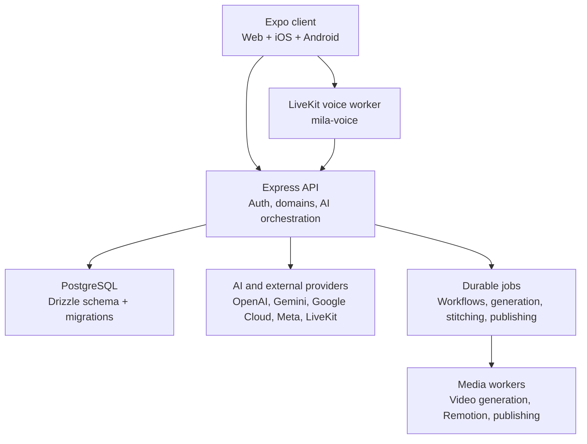

## Architecture

Nomila is a cross-platform creator intelligence system composed of an Expo client, a TypeScript/Express API, a PostgreSQL-backed domain model, AI orchestration services, durable background execution, and specialized media and voice runtimes.

### Client Layer

The client is an Expo and React Native application targeting web, iOS, and Android from a shared codebase.

The client is organized around:

- React Navigation for application routing
- TanStack Query for server-state fetching and cache management
- Firebase Authentication for user identity
- Shared TypeScript contracts from `shared/`
- Feature-specific screens, hooks, and components
- Platform-specific implementations where web and native behavior differ

`client/App.tsx` owns application bootstrap and root gating. These gates determine whether the user sees authentication, waitlist, onboarding, profile selection, account-deletion state, or the main application shell.

The client does not contain core business rules. It requests domain operations from the API and renders typed results, cards, streams, previews, and approval states returned by the server.

### API and Domain Layer

The backend is a TypeScript and Express service started from `server/index.ts`.

The API is organized by domain rather than generic CRUD controllers:

- Authentication and identity
- Athlete profiles and records
- Deals, inboxes, contracts, and negotiations
- Brand intelligence and brand books
- Research and athlete intelligence
- Mila chat and agent conversations
- Voice integration
- Studio generation and editing
- Video stitching and publishing
- Bookings, payments, and financial records
- Public cards, partner intake, and public pages
- Admin, cron, webhook, and operational endpoints

Routes are mounted under explicit boundaries such as:

- `/api/v1/auth`
- `/api/v1/me`
- `/api/v1/admin`
- `/api/v1/public`
- `/api/internal/voice`
- Public payment, partner, booking, and card routes

Authentication is applied at the route boundary. Athlete-scoped routes derive tenancy from the verified Firebase identity rather than trusting client-provided athlete IDs.

The server also applies security headers, CORS allowlists, request logging, rate limiting, internal shared-secret checks, and feature-flag gates before requests reach domain handlers.

### Database and Persistence

PostgreSQL is the system of record. Drizzle ORM provides typed queries, while the database schema is defined in `shared/schema.ts`. Schema changes are represented as ordered SQL migrations under `migrations/`.

The database stores both product data and execution state, including:

- Athletes, identity claims, affiliations, and profiles
- Deals, opportunities, contracts, deliverables, and payments
- Inbox brands, threads, messages, and attachments
- Social identities, analytics, research evidence, facts, and inferences
- Media assets, media rights, content kits, and posts
- Mila conversations, messages, summaries, sessions, and agent runs
- Studio plans, brand profiles, reference analyses, generation previews, and edit previews
- Video generation, stitching, and publishing jobs
- Durable workflow runs and workflow steps
- Public cards, partner requests, bookings, and financial ledgers

The schema uses foreign keys, composite ownership constraints, unique indexes, check constraints, status machines, and append-oriented records to protect tenant isolation and make retries safe.

### Mila Agent Architecture

Mila has one server-side execution path: Mastra, implemented under `server/agent/engine/mastra/`.

Every Mila surface—including chat, onboarding, waitlist, proactive suggestions, and related flows—ultimately calls the same `runMilaTurn` contract.

A turn consists of:

1. Resolve the authenticated athlete and conversation.
2. Load bounded context from PostgreSQL.
3. Seed the model with recent chat gaps, summaries, athlete facts, attachments, and relevant product context.
4. Admit the run under per-athlete concurrency and cost limits.
5. Execute the Mastra agent with only the tools permitted for that surface.
6. Stream text and tool status to the client over SSE.
7. Persist the response, tool calls, usage, costs, approvals, and trace metadata.
8. Fold the conversation into a bounded rolling summary.

Tools are implemented in Nomila’s domain code rather than delegated to the model runtime. This keeps business rules, authorization, data tenancy, tool schemas, spend limits, and approval requirements under application control.

Agent execution is recorded in `agent_runs`. Runs support:

- Per-athlete concurrency limits
- Per-run and per-day spend caps
- Maximum model steps
- Explicit stop and cancellation behavior
- Approval states for actions requiring user confirmation
- Conversation takeover semantics
- Web-search accounting
- Langfuse and OpenTelemetry tracing
- Zero-data-retention model configuration where supported

### Voice Architecture

Voice is split into two trust zones.

The main API owns:

- Authentication
- Short-lived LiveKit token minting
- Athlete-bound voice grants
- Voice-specific read models
- Voice tool endpoints
- Athlete score, deal, profile, brand, and context lookups

The separate `mila-voice` worker owns the real-time LiveKit session and model interaction.

The worker calls `/api/internal/voice` endpoints using infrastructure authentication. These endpoints deliberately expose reduced, voice-safe response shapes instead of passing raw database records or brand-authored text into the speech model.

For example, the voice boundary exposes structured deal facts, fit grades, presence flags, and approved numeric fields while filtering untrusted email text and other prompt-injection material.

### Studio and Creative System

The Studio is a domain-specific creative pipeline rather than a single model call.

A typical Studio request moves through:

1. Reference or brand asset selection
2. Ownership and rights validation
3. Brand, profile, and reference analysis
4. Creative intent interpretation
5. Structured brief and plan generation
6. User confirmation or approval
7. Provider execution
8. Preview and QA gates
9. Media asset persistence
10. Optional stitching, publishing, or campaign association

Studio capabilities include:

- Image generation
- Image editing operations such as recoloring, garment changes, product treatments, background cleanup, and ad composition
- Brand-aware creative generation
- Reference decomposition
- Creative planning and campaign briefs
- Video generation
- Clip assembly and stitching
- Captions, music, and timeline composition
- Publishing workflows

The system separates interpretation, planning, generation, editing, stitching, and publishing so expensive or irreversible operations are explicit and independently auditable.

Provider adapters under `server/studio/adapters/` isolate model-specific behavior. The rest of the application works with stable internal contracts instead of depending directly on provider APIs.

### Durable Background Execution

The application intentionally avoids requiring a separate queue or workflow platform for core execution.

Workflow state is persisted in PostgreSQL:

- `workflow_runs` represent logical processes
- `workflow_steps` represent executable steps
- Ready rows act as the queue
- Database leases act as distributed claims
- `FOR UPDATE SKIP LOCKED` prevents duplicate claims
- Heartbeats extend active leases
- Expired leases are reclaimed
- Failed steps retry with exponential backoff and jitter
- Step completion uses compare-and-set ownership checks

This provides at-least-once execution across Cloud Run instances while keeping the operational surface small.

Every side-effecting step must be idempotent. Writes are keyed by run and step identity, external calls use provider idempotency keys where available, and irreversible actions happen only after all failure-prone preparation has completed.

Studio generation, video stitching, and publishing use their own persisted job tables because they have different provider-operation, polling, cost, and failure semantics from ordinary workflows.

Local development does not automatically execute shared background work. The server only runs background consumers on Cloud Run, in tests, or when `LOCAL_BACKGROUND_WORK=true` is explicitly set. This prevents a developer laptop connected to the shared development database from accidentally claiming shared jobs or spending provider credits.

### External Services and Deployment

The production topology uses:

- Cloud Run for the API
- Cloud SQL for PostgreSQL
- Secret Manager for credentials and API keys
- Artifact Registry for container images
- Firebase Hosting for the web application
- EAS for native preview and update workflows
- LiveKit for voice sessions
- A dedicated media renderer for Remotion-based rendering
- External AI providers for language, vision, image, and video generation
- Meta, Google, Microsoft, TikTok, Spotify, YouTube, Shopify, Stripe, and email integrations

CI workflows handle type checks, tests, container builds, Cloud Run deployment, database migration, Firebase web deployment, renderer deployment, and EAS updates.

Production deployment is separated into API, web and landing, and media-renderer concerns. This allows the API to scale independently from long-running media work and prevents a video render or provider poll from blocking ordinary API traffic.

### Design Principles

The architecture is built around several principles:

- PostgreSQL is the source of truth for product state and execution state.
- Business logic belongs in domain services and typed tools, not UI code or model prompts.
- AI outputs are interpreted into constrained application contracts before they cause side effects.
- User actions that spend money, publish content, send messages, or change durable state require explicit approval paths.
- Every external boundary has a narrower contract than the internal database model.
- Background work is retryable, observable, leased, and idempotent.
- Tenant ownership is enforced server-side at every data access boundary.
- Expensive model and media operations are tracked for cost, provenance, and replayability.
- Feature flags allow incomplete or risky capabilities to ship behind explicit gates.
