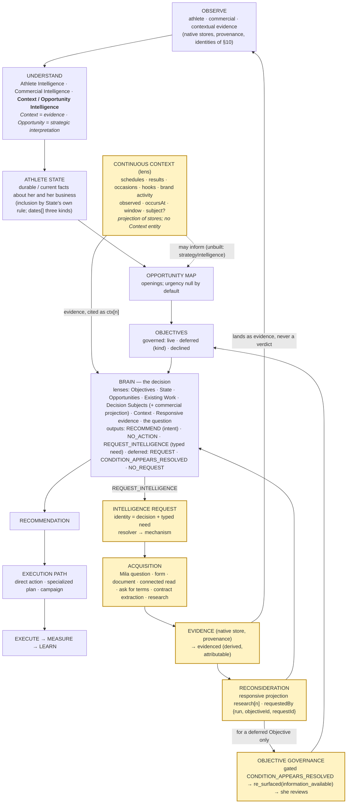

# Context / Opportunity Intelligence — design/repo/evidence checkpoint against #608, 27 Sep 2026

**Control:** `context-intelligence.md` (#608, branch `docs/context-intelligence`, canonical). This page does not rewrite it. It re-reads its decisions, tests them against everything recorded since (56 gated Brain runs, the R1 pair, the acquisition seam, the resurfacing bridge), and proposes amendments only where that evidence requires them (§13). No provider call, no implementation, no mounting.

**In plain words.** #608 said: context is evidence; the Brain decides what it means; research happens before and alongside the Brain, continuously and on request. Everything since has confirmed the first two sentences and *built* the third's second half. What the evidence adds is sharper than #608 could be at the time: which contextual facts belong in Athlete State and which stay Decision-relative; that the request mechanism now exists and has a typed shape; that "context is not inference" has four named instances; and the smallest freshness and identity semantics the real cases needed. The canonical loop is unchanged; the targeted path is a loop back into evidence, drawn as such (§14).

---

## 1. #608 decisions, as originally recorded

| # | decision (#608 §) | as written |
|---|---|---|
| D1 | §1 principle | "Research and context gathering happen before and alongside the Brain. The Brain decides what Nomila should do with it." Context is evidence with source, time, confidence; it enters through a canonical store with provenance and is read through State or as a cited input; it carries no verdict. |
| D2 | §1 | Not every contextual signal becomes an Opportunity, Objective, Recommendation or Campaign; Context Intelligence is not a task generator. |
| D3 | §2.1 continuous mode | Schedules/competition, results/moments, events/occasions, news/trends, brand activity, existing obligations — recorded as evidence in the stores that exist or would (`State.dates[]` empty; `athlete_events` never built; `research_evidence` signal rows read by nothing). Periodic and shared where the world is the subject; per-athlete where her world is. |
| D4 | §2.2 targeted mode | Intelligence that lacks something material may **request** targeted research, receive the result as citable evidence, and reconsider. Invokable, not scheduled. StartX1 is the canonical case; "Research must be an invokable capability … the Brain's outputs must include 'I need to know X'". |
| D5 | §3 spine | Context Intelligence is an UNDERSTAND-layer capability; one Brain; the research loop is a loop, not a stage; results re-enter as evidence, never as free-floating facts — "answers flow through State or a citable evidence block, never directly into an evaluator". |
| D6 | §3.1 ownership | Context may say "Stanford plays USC on Saturday; source, as-of, confidence"; may not say "post about it". Brain owns strategic meaning and the request; Campaign/Creative owns expression; Studio owns making. |
| D7 | §4 seams | `OpportunityEvidence.strategyIntelligence / .targetedResearch` (declared, null); the parked gap router (proposition → materiality → source class → question); deferral `information` kind with `information_available` (no writer); `State.dates[]`; the Campaign `observed` door. Nothing needs a new layer. |
| D8 | §5 not | Not a monitoring platform, not a second brain, not a content calendar, **not a reason to widen State casually** — context enters State only where it is a fact about her own situation with a citable path. |
| D9 | §6 Brain constraint | NO ACTION and REQUEST INTELLIGENCE are first-class, non-failing outputs; a request is a recorded event on the decision it blocks; when the answer lands as evidence the Brain reconsiders with it citable. |
| D10 | §7 #309 | Occasion derivation maps to continuous context; plan-item shaping maps to a specialized planner behind an execution path; "#309 as the Brain's spine" is superseded; close #309 with a pointer. |
| D11 | §8 sequence | Empirical first: schedule · recent result · upcoming occasion · obligations; measure what changed a recommendation before building any collector. |
| Q1–Q7 | §9 | State or Brain input? · who owns materiality? · persistence of a targeted answer as evidence-as-seen · Opportunity two-pass = Brain-requested research? · what writes `information_available`? · freshness and cost · the Strategy Orchestrator. |

## 2. The empirical corpus — contextual facts that affected, or tried to affect, the Brain

56 gated runs scanned (`docs/audits/artifacts/brain-context-experiment-1/**`). Citation counts by prefix: `opportunity` 168 · `findings` 139 · `commercialPosition` 136 (of which `inbound[n]` 125) · `objective` 133 · `work` 83 · `contentPerformance` 78 · `deferred` 46 · `representation` 43 (floors 40) · `ctx` 30 · `request` 30 · `audienceTrajectory` 27 · `deal` 17 · `preferences` 12 · `materialGaps` 5 · `research` 2. `dates` was never cited (empty for every athlete).

| # | fact | source · store | freshness | athlete / world | durable / ephemeral | class | belongs in | what went wrong (or right) |
|---|---|---|---|---|---|---|---|---|
| 1 | schedule gap: one away fixture in the window; 26-day gap between home matches (`ctx[0]`, `ctx[1]`, 29 cites) | hand block from gostanford.com; `observedAt` 26 Sep; dates only in prose | window-bound (26 Sep → 16 Oct) | athlete-world | ephemeral | observed (researched) | **Decision context** (continuous, athlete-world) | **gap → capacity** ("highly feasible operational window", R4; recurring on audience/Yuwa decisions). A schedule is evidence about the schedule, not about availability. Placement right; inference wrong |
| 2 | recent result, campus occasion, USWNT hook, F1 control (`ctx[2]`, `[3]`, `[4]`, `[6]`) | hand block | window-bound | world / athlete-world | ephemeral | observed | Decision context | **never cited** in 56 runs — noise until a Decision asks; the control behaved as a control |
| 3 | StartX1 inbound signals (`commercialPosition.inbound[3]`,`[6]`,`[9]`, 125 cites of `inbound[n]`) | `inbox_threads` classification (`deal_detected`, PAID); `received_at` | dated events (2, 4, 14 Sep) | athlete-specific | semi-durable (an event stays true) | measured/classified | **State** (`commercialPosition.inbound`, `dates.inbound_deadline`) | **subject-adjacent read as responsive** — five false resolutions of the StartX1 deferral (R1). Placement right; attribution missing → fixed by the 0.8.1 rule and the R1 pair |
| 4 | gorjana: deadline 30 Sep, thread awaiting reply, deliverables not recorded (`work[gorjana].thread`, `deal[gorjana]`, K1/G0/G1) · brand site has no dated drop (`ctx[5]`, 1 cite) | `deals` + thread classification `deadline` (→ `State.dates`); `inbox_brands` / hand brand item | deadline dated; brand item observed 26 Sep | athlete-specific / world (brand) | deadline ephemeral; relationship durable | measured · observed | **Existing Work** (item) + **State** (`dates`, `closedDeals`) · **Context/brand** | right: REQUEST for what is owed; the absence statement was cited as absence, not converted (Stage 1 §6) |
| 5 | INIU inbound thread, terms NOT stated (`work[INIU]`, `deal[INIU].offer/.basis/.completeness`, S0/S1) | `deals` (detected) + thread; Commercial projection | current | athlete-specific | in motion | measured + projected | **Existing Work** + **Commercial projection** on the subject | right after 0.5.0 zero-record rendering; before it "0 deliverables" was read as zero things (R7) |
| 6 | Northlight term sheet: USD 5,000 / 1,250 per deliverable, exclusivity none, timeline absent, usage UNKNOWN (`work[…].band/.basis/.absent/.unknown`, 39+ cites) | controlled overlay (deal-shaped) + Commercial projection | current | athlete-specific | in motion | declared (counterparty) + projected | Existing Work + Commercial projection | pre-0.5.0: **floors summed, rate card values computed** (A1), "not stated" for unknown; fixed by invariants 1–2 and the projection; 7 of 7 consumed `.band` after |
| 7 | Ronaldo public fame/earnings (679 M followers, USD 65 M off-field, `findings`) | researched external facts, in State findings | durable-ish (annual) | world-facing fact **about the athlete** | durable | researched | **State** (`findings`) — correct placement | **fame/earnings → pricing basis** (C0, 0.4.0/0.6.0 C2 declines "extreme undervaluation"); fixed by invariant 1 ("a basis is established or it is not"). The failure was interpretation inside State, not placement |
| 8 | TikTok series in production (R1 overlay) | controlled work item | in motion | athlete-specific | in motion | declared | Existing Work | right: **NO_ACTION** — work already advances the Objective |
| 9 | CSR proposal sent to six brands, no reply (R4 overlay) · Yuwa pending proposals | controlled work item | in motion | athlete-specific | in motion | declared | Existing Work | noticed (`advances_existing_work`) but a **plan was manufactured while waiting** |
| 10 | responsive research projection (`research[0]`, P, PB) | `inbox_messages` (controlled reply) → evidenced request → projection with `requestedBy` | dated (`asOf` = evidence time) | athlete-specific (her counterparty's terms) | Decision-relative | connected evidence, projected | **Requested-evidence lens** (attributable) | right: cited as the only resolving evidence twice; naming pressure (read as "research") |
| 11 | athlete assertion through the seam (`cadence`, Paytest) | `athlete_asserted` (run_id, receipt) | `created_at` only | athlete-specific | durable until superseded | asserted | **State** (if a State reader keys on it) **and** requested-evidence projection for one request — same row, two projections | right: attributable, `evidenced`; not in State because no reader keys on `cadence` — correct by State's own inclusion |
| 12 | brand/profile evidence (`inbox_brands.enrichment`, `brand_fit_narratives`, `ctx[5]`) | per-brand, `enriched_at` (90-day re-enrich) | dated | world (brand) | semi-durable | researched | **brand intelligence projection on the brand subject** (Decision Subject kind `brand`) | cited once, correctly; excluded from State by design |
| 13 | MIA findings (`narrative_power` 69, `brand_fit` 23, `audience_scale` 23 …) | intelligence ledger | `evidence_as_of` | athlete-specific | durable | inferred (versioned) | State | cited on nearly every RECOMMEND; correct |
| 14 | content performance / audience trajectory (78 + 27) | `social_features` (`as_of`, window) | dated windows | athlete-specific | current | measured | State | correct ("555 days since a TikTok post" drove the audience decisions) |
| 15 | representation floors (40 cites) | athlete settings → `representation.floors` | current | athlete-specific | durable until changed | declared | State | pre-0.5.0 **used in arithmetic** (a floor chosen as the ask; rate cards); fixed by invariant 2 |
| 16 | PB live: AEGISLAB / Connect Me / Pillar negotiations, terms and profile unrecorded (`deal[…]`) | `deals` (negotiating) | current | athlete-specific | in motion | measured | Existing Work / Decision Subjects | right: REQUEST for terms/profile |
| 17 | onboarding goals (`preferences[onboarding_goal.*]`, 12) | `athletes.goal_archetype` (`claimed_at`) | point-in-time | athlete-specific | durable | declared | State | correct |

**Two readings the corpus forces.** (i) Every placement #608 implied was right; every failure was **interpretation** — capacity from a schedule, resolution from adjacency, price from fame, an ask from a floor. (ii) The Brain read athlete-proximate context directly (30 `ctx` cites, all schedule and one brand absence) and world context never; the Opportunity Map cited State paths only. Context reached decisions **directly**, not through Opportunities, in every recorded case.

## 3. State versus Context — the principle, tested

> Athlete State holds durable/current facts about the athlete and her business that are broadly useful across Decisions. Context holds time-sensitive, external, situational or Decision-relative facts whose relevance depends on the question asked.

| item | by the rule | in the repo / corpus | verdict |
|---|---|---|---|
| athlete cadence assertion | State (durable, hers) | `athlete_asserted` row; State reads assertions only by field regex; the same row projected as requested evidence for one request | holds, with the refinement: **one evidence row, two projections** — State's, and the request's |
| current deal obligations | State (her business, broadly useful) | the *dates* are in State (`dates.deal_term_end`, `inbound_deadline`); the *items* are Existing Work with identity, commercial projections attached per Decision | holds: **fact in State, item as a lens** — not one store |
| schedule / fixture | Context (time-bound) | no store; hand block; the only cited context | holds. Season phase ("in season until November") is the borderline — durable-ish and broadly useful — **stays Context until a Decision needs it as a State fact** (D8: do not widen State) |
| open negotiation | both | `State.commercialPosition.pipeline` (counts) + the Existing Work item | holds |
| historical commercial relationship (gorjana) | State | `closedDeals`, `activeRelationships` | holds |
| current campaign | Context/Existing Work | **no campaign store** (`campaign` is a text label on deliverables and a Subject kind with nothing behind it) | holds by absence; obligations' dates would enter State via `dates` when the Campaign slice lands |
| public earnings estimate | State (durable fact about her) | `findings`; caused the fame→price failure | **holds — and exposes the second refinement: placement ≠ meaning.** State membership never licenses inference; invariants govern meaning inside State as much as in Context |
| upcoming cultural moment | Context | `ctx[3]`, `ctx[4]`; never cited | holds; noise until asked |
| inbox signal | State (dated event about her) | `inbound[n]`; the R1 failure | holds; the failure was attribution, not placement |
| brand news / activity | Context (world) | `ctx[5]`; no store; `research_evidence` signal rows read by nothing | holds |

**Counterexamples found: none that break the rule; two refinements it needs.**
1. **Placement ≠ meaning.** A durable State fact (earnings, a floor, an inbound) is still evidence; what it *means* for a Decision is governed by the relevant contract (invariants 1–2, the attribution rule), not by where it sits.
2. **One row, several projections.** Evidence keeps one identity in its native store; State projects it by State's inclusion semantics; a request projects it as responsive evidence; a subject carries its commercial projection. Nothing is forced into exactly one place; nothing is copied.

## 4. Context is not inference — recorded instances

| evidence | is not | what governs the meaning | where the governance lives |
|---|---|---|---|
| a gap in the competition schedule | athlete capacity or availability | availability is a State fact she asserts or a constraint; the spec forbids inventing capacity | **Brain contract** (Decision-relative; R4 open — no rule yet) |
| inbound interest on the same subject | the deferral condition resolved | responsive, attributable evidence for the request; the Brain's judgment on her condition | **Brain contract + Gate 2** (0.8.1) — closed |
| public earnings / fame | a pricing basis | a basis is established or it is not (invariant 1); the Commercial projection | **Commercial Intelligence** (upstream, projection) + Brain invariant — closed |
| new evidence about a subject | responsive evidence | attribution (`requestedBy.requestId`) | **Intelligence Request** (upstream) + Gate 2 — closed |

Rule for where interpretation lives: **when the meaning is a property of the evidence itself** (a basis is or is not established; a reply is or is not attributable to a request; a deliverable is or is not recorded), it belongs **upstream in specialized intelligence** as a projection the Brain cites. **When the meaning depends on the question** (does this gap matter for *this* Objective now; is *this* evidence sufficient for *her* condition), it stays **Decision-relative in the Brain**, bounded by the contract's invariants and gates. The schedule-gap case is Decision-relative (whether a quiet fortnight matters is a judgment); what is *not* the Brain's is turning it into capacity — the missing line is a Brain-contract invariant, not a Context field (§13 A6).

## 5. Continuous-context contract (D3, refined)

Keep `context-block/0.1.0` as the shape (`kind · statement · source{title,url,observedAt} · confidence · control?`, cited `ctx[n]`) with these refinements, all evidence-driven:
- **Observations, never verdicts** (D1) — unchanged; the spec line "None is a verdict" held in every run.
- **Add structured time where the case had one** (§11): optional `occursAt` (a fixture, a match, a deadline) and, for a period, `window {from,to}` on the item; `observedAt` stays mandatory. Today the date is inside the prose.
- **Add an optional subject reference** (`SubjectRef`: athlete · brand · opportunity · deal) so a brand-activity item can attach to `brand[…]` and be read through Decision Subjects rather than only by index. No new kind of identity (§10).
- **Assembled from stores when stores exist; hand-assembled until then**, labelled (`assembledBy`). Today no schedule, occasion, hook or brand-activity store exists; obligations and inbound deadlines already reach State (`dates`) and Existing Work — the block must **not** duplicate them.
- **Not a task generator** (D2) — nothing consumes a context item except a Brain citation; no item creates work.
- **State is not widened for it** (D8): `dates[]` keeps its three kinds; a season phase or a fixture becomes a State fact only through State's own inclusion rule and a citable path, when a Decision needs it there.

## 6. Targeted-intelligence contract (D4, D9 — now built)

#608's "request targeted research → receive a versioned evidence block → reconsider" is now a specific, experimentally closed mechanism, and **it is the only targeted-intelligence architecture**:

`Decision (identity: source · subject · question)` → `REQUEST_INTELLIGENCE` (proposition · why material · source class · **typed need**) → **Intelligence Request** (identity = decision + need) → **resolver** (need × capability facts → mechanism: Mila question · form · document · connected read · ask for terms · contract extraction · targeted research · brand research) → **acquisition** (a workflow step / a connected read / a research run, carrying the request id) → **evidence in its native store with provenance** → `evidenced` (derived: attributable · right need · authority ≥ required · after the request) → **reconsideration eligibility** → the Brain reconsiders with the evidence projected as `research[n]` (`requestedBy {run, objectiveId, requestId}`) → governance consequence (for a deferred Objective: gated `CONDITION_APPEARS_RESOLVED` → `re_surfaced(information_available)`).

How this amends D4/D7: the "targeted research block `{version, block}`" of #608 **is** the responsive-evidence projection of an evidenced request — the envelope `targeted-research/0.1.0` is reused for every source class (athlete, connected, external), which is the naming pressure already recorded. The gap router **is** the resolver (typed need in, mechanism out; materiality is the Brain's `why_material` for Decisions and Opportunity pass 1's question for openings — Q2). `OpportunityEvidence.targetedResearch` should consume the same projection when pass 2 is built — **one executor, two invokers** (Q4), not a second architecture. External "targeted research" (the researcher over `research_evidence`) is one *mechanism* the resolver may select, not the mechanism.

## 7. Persistence and provenance — the hypothesis, tested against the repo

| claim | evidence | holds? |
|---|---|---|
| raw/acquired evidence persists in its native store with provenance | `athlete_asserted` (run_id, mode, source, receipt); `inbox_messages` (thread/external ids, received_at); `research_evidence` (published_at, retrieved_at, dedupe_key, superseded_by) | **yes** — the acquisition seam wrote through the existing path; nothing was copied |
| the Intelligence Request carries attribution, by reference | `evidenceRefs[] {store, id, at, sourceClass, need, attributedTo, asserts}`; the step output names the request id beside the row ids | **yes** |
| specialized intelligence may create interpreted projections | Commercial projection (`deal-assessment-projection/0.1.0-exp`) on the subject; the responsive-evidence projection | **yes** |
| the Brain receives the projection/evidence relevant to the Decision | `research[n]`, `deal[…].band`, subjects | **yes** |
| Athlete State changes only by its own inclusion semantics | `cadence` did not enter State (no reader keys on it); a floor would enter via `representation.floors` only through the settings path; nothing in the seam writes State | **yes** — Brain-requested evidence does not become State automatically |
| a targeted answer is persisted as evidence-as-seen (Q3) | the run artifact records `inputs.research` byte for byte (the proposal-set pattern: `state_snapshot`, `opportunity_map`, digests) — **but the Brain has no run table**; the request ledger is a harness file | **partly** — the discipline is followed in artifacts; a production Brain run record and a request store are the pressures (R9) |

## 8. Relationship to Intelligence Requests

Continuous context and targeted intelligence are joined only at the evidence stores and at the Brain's inputs: a context item may *prompt* a request (the Brain names a gap after reading it); a request's evidence may *land* in a store the continuous mode also reads (an inbox reply is both a thread event and responsive evidence). The request never becomes a context item and a context item never becomes evidenced by itself: **attribution is what separates them**, and it is explicit (`attributedTo`, `requestedBy.requestId`). The Intelligence Request owns "what is missing"; Context owns nothing about missingness.

## 9. Proposed Brain input lenses — the smallest stable separation

| lens | provenance | semantic role | keep? |
|---|---|---|---|
| Objectives (live / deferred / declined) | governed by her | what may be recommended on; standing conditions; closed | keep (governance) |
| Athlete State | State assembler, cited by path, `asOf` | durable/current facts about her and her business | keep |
| Opportunity Map | the Opportunity evaluator, rests on State paths | strategic interpretation (openings; urgency null by default) | keep — interpretation, not evidence |
| Existing Work | deals (+ campaigns when they exist), with identity and status | what is already in motion (advances / duplicates) | keep |
| Decision Subjects | typed refs to unrendered subjects | what a decision is *about*; carries commercial/brand projections | keep (0.6.0) |
| Commercial projection | Commercial Intelligence, attached to a subject | established-or-not meaning of terms | keep as a **projection on subjects**, not a block |
| Context | continuous observations, dated, with source | situational evidence whose relevance depends on the question | keep, separate from State (§3) |
| Responsive evidence (`research[n]`) | an evidenced Intelligence Request, attributable | what was asked for, for which Decision | keep, separate from Context — attribution is the difference; rename pressure recorded |
| Decision Requested | the request block (source · subject · question) | the question itself | keep |

Separation is by **provenance × role**: governed intent · her facts · strategic interpretation · in-motion items · situational observations · responsive evidence · the question. Collapsing any pair loses either a provenance the gates check (`research[n]` attribution; `work[…]` identity) or a role the spec relies on (State may be cited for facts; Context may not be read as capacity; Opportunities are not evidence). No lens is added.

## 10. Context identity and deduplication — projection, not an entity

Existing identities are sufficient for every source that has a store: `inbox_threads (athlete, external_thread_id)` + aliases · `inbox_messages (thread, external_message_id)` · `deals.id` + `deal_group_id` · `deal_periods / deal_deliverables (deal, seq)` with `superseded_at` · `research_evidence.dedupe_key` (non-unique) + `superseded_by` · `social_features` natural key · `athlete_asserted.id` + `superseded_by` · `objectives (proposal_set, proposal_key)`. Sources with **no store and no identity**: schedule/fixtures, occasions, sport-wide hooks, brand activity, news items (only `research_evidence` signal rows, unread). **Decision: no universal Context entity.** The Context lens projects existing rows (cite by a stable locator when projected: `ctx[<store>:<id>]` instead of a bare index — an amendment when a projector exists, not now). The first source that will need a new identity is the schedule item, and only when a collector exists: a natural key such as `(athlete, source, occursAt, opponent)` — not designed here.

## 11. Minimum freshness semantics, from the real cases

| distinction | where it exists today | needed by a recorded case? |
|---|---|---|
| observed at (when Nomila saw it) | every store (`retrieved_at`, `observed_at`, `created_at`, `source.observedAt`) | yes — every context item; the block's `asOf` |
| occurred / occurs at (when the thing is or was) | `inbox_messages.received_at`, `deals.term_*`, `deal_deliverables.due_on`, `social_metric_observations.entity_time`, `objective_events.at`; **not** in `ContextItem` (prose only) | **yes** — fixtures, results, deadlines; the schedule-gap reasoning was about occurrence dates it had to parse from prose |
| valid from / to | `deals.term_start/end`, `deal_periods`, `athlete_facts.valid_from/to`, `athlete_affiliations.started/ended_on` | only where a store already has it (obligations); no context case needed it |
| acquired at (when acquisition ran for a request) | `evidenceRefs.at` (= the evidence's own time), the step's `finished_at`, `raisedBy.at` | yes — "after the request" is the rule's test |
| stale / unknown | research TTL families (`policy.ttlDays`), `staleAfter`, `Freshness = fresh\|stale\|unknown` in canonical context; **none** on State, Context or the Map | no context case failed on staleness; the window + `observedAt` were enough |

**Minimum for Context:** `observedAt` (mandatory) + `occursAt?` / `window?` (structured, optional) + the block's `asOf` and `window`. No staleness computation for Context; no universal temporal ontology. The pressure recorded elsewhere stands: `athlete_asserted` has no observed-time; the Map and State have no age term.

## 12. Context → Opportunity

The box "Context / Opportunity Intelligence" stays, with its internal split made explicit: **Context is evidence; Opportunity is strategic interpretation.** The four ways context may act, and what the record shows:

| context may … | mechanism | recorded |
|---|---|---|
| create an Opportunity | the Opportunity evaluator reading `strategyIntelligence` / a State fact | unexercised (`strategyIntelligence` null in 1.0.0); the Map cited State paths only |
| change the urgency of an Opportunity | map recompute with `urgency` (null by default — "a required rating would manufacture pressure") | unexercised |
| affect a Decision without an Opportunity | the Brain citing `ctx[n]` directly | **yes — the only observed mode** (the audience decision re-timed on the schedule gap) |
| provide evidence requested by the Brain | the Intelligence Request loop | **yes** (P, PB) |

So: Opportunity remains the strategic-interpretation layer and Context remains evidence; the direct Context→Brain path is real and the Context→Opportunity path is design-only. Not every contextual fact becomes an Opportunity — in the corpus, none did.

## 13. Exact amendments proposed to #608 (not rewrites)

| # | #608 place | amendment | why (evidence) |
|---|---|---|---|
| A1 | §2.2 | "request targeted research … receive the result as citable evidence" → *the Intelligence Request is the targeted mechanism: typed `need`, resolver, acquisition by the mechanism the need admits, evidence in its native store, `evidenced` derived, reconsideration with the responsive projection `research[n]` carrying `requestedBy {run, objectiveId, requestId}`.* External research is one mechanism, not the mechanism. | 0.8.0 → 0.8.1 → the seam → the bridge (§6) |
| A2 | §4 (deferral kind) and §9 Q5 | "Targeted research is the obvious writer [of `information_available`]" → *the writer is the Objective consumer, on a gated `CONDITION_APPEARS_RESOLVED` attributable to the evidenced request (option B); evidence arriving is eligibility, not resolution.* | the R1 pair; the confirmation run; the frozen responsibilities |
| A3 | §9 Q1 | athlete-world dated facts (schedule, occasions) reach the Brain as the cited Context block; they enter State only through State's own inclusion (`dates[]`, three kinds) when a Decision needs a State fact; world context is Context. `dates[]` is part of the seam, not the seam. | §2–3: all 30 context cites were direct; State placements all held |
| A4 | §9 Q2 | **Context does not determine strategic materiality. Opportunity Intelligence may determine whether context constitutes or changes a strategic opportunity. The Brain determines its materiality to the Decision currently being evaluated** (`why_material`, gated). The resolver never judges materiality. (Wording refined at review, 27 Sep, so the two scopes are explicit and not competing.) | 0.8.0 contract; the resolver is a pure mapping |
| A5 | §9 Q3 / Q4 | persistence of a targeted answer = the run record's inputs byte-for-byte (proposal-set discipline), with the request ledger as the attribution store — both pending a production Brain run record; Q4 confirmed as *one executor, two invokers*: pass 2 consumes the same projection. | §7 |
| A6 | §1, add | "Context is not inference": schedule gap ≠ capacity · inbound interest ≠ condition resolved · public earnings ≠ pricing basis · new evidence about a subject ≠ responsive evidence. Property-of-evidence meaning lives upstream as a projection; question-dependent meaning stays in the Brain under invariants. The schedule-gap line is the one still lacking an invariant (R4). | §4 |
| A7 | §5 last bullet | affirm, with the refinement *placement ≠ meaning* and *one row, several projections* | §3 |
| A8 | §9 Q6 | minimum freshness: `observedAt` + structured `occursAt`/`window` on context items; no staleness computation for Context; no ontology | §11 |
| A9 | §3 diagram | draw the targeted path as the loop it now is (§14); label the Brain's inputs by the seven lenses of §9 | §9, §12 |
| — | §6, §7, §8, D2, D8, D10 | **no amendment** — confirmed by the corpus | — |

## 14. The canonical architecture, zoomed in — amendments highlighted

Highlighted: the continuous-context lens (with the minimum time fields and no entity), and the targeted path drawn as a loop from the Brain back into evidence and reconsideration, with the Objective consequence as the one governance consumer. The main loop is unchanged.

## 15. What remains empirical

- Whether a **store-projected** context block (not hand-assembled) reads the same to the Brain; no collector exists.
- Whether **world context ever changes a decision** — 0 of 56 runs used it beyond one brand-absence cite.
- The **schedule-gap inference** (R4) under an invariant line — untested; the only open "context is not inference" instance.
- **Context → Opportunity** (pass 2 / `strategyIntelligence`) — design-only.
- Repeatability of any of the above — deliberately not run.

## 16. Smallest next experiment, if one is necessary

None is necessary to adopt the amendments in §13; they are recorded from evidence already in hand. If one is run, the smallest with a real question is **R4 under a Brain-contract line** (by ceremony: amend → bump → unpin → parity → review → repin): the same V3 inputs with `ctx[0]`/`ctx[1]`, one call, asking only whether the audience decision still converts a quiet schedule into an "operational window". Everything else in §15 waits for a store or a collector, which #608 §8 places after the Brain contract, not before.

## 17. Not done

No provider call. No implementation, mounting or materialisation. No collector, scheduler or table. No Deals, Rate, Objective, Recommendation, Campaign/Studio or brand-relationship change. No repeatability matrix. #608 remains the control and is not edited here; #570 untouched.

---

## 18. Review outcome (27 Sep 2026) — accepted

**Main architectural result: #608's placement survived the empirical evidence.** The later experiments refine its contracts; they do not require moving Context into State or replacing the canonical architecture.

- **State / Context rule adopted with both refinements:** (1) *placement does not license meaning* — valid State does not validate every inference from it, valid Context does not determine strategic meaning (schedule gap ≠ capacity; inbound interest ≠ condition resolved; earnings/fame ≠ pricing basis; floor ≠ execution ask — each a failure of interpretation, not placement); (2) *evidence persists once and may project many ways* — one provenance-bearing item may appear through State, Context, Commercial Intelligence, an Intelligence Request and a Decision-specific Brain input without duplicating the evidence; the cadence assertion is the precedent; projection is not copying provenance.
- **Targeted intelligence amendment approved** (A1): the targeted mode is the established loop; external/web research is one acquisition mechanism, not a synonym for targeted intelligence; no second targeted-research architecture beside Intelligence Requests.
- **Persistence approved** (§7): native store · provenance on the original · request carries attribution · specialized projections · Brain receives projections · State changes only by its own inclusion contract. A Brain request does not make a fact State.
- **Context identity approved** (§10): no universal Context entity; existing identities kept; schedule / occasions / hooks / brand activity get no invented identity before a real collector/lifecycle requires one; Context remains a lens.
- **Freshness approved experimentally** (§11): observed-at, and occurs-at / occurrence window where applicable; no universal staleness score or temporal ontology; producers may define their own freshness later.
- **Materiality wording refined** (A4 above).
- **Both Context paths preserved:** Context → Brain is real and exercised; Context → Opportunity is design-supported and empirically unproven. Context is never forced through Opportunity before the Brain can see it. Context may directly affect a Decision · create a new Opportunity · change an existing one · change timing/urgency without changing it · be irrelevant · be responsive evidence for a request. Opportunity is a strategic interpretation of evidence/context, not a mandatory wrapper around Context.
- **The nine amendments are adopted** without a provider call. The schedule-gap call (§16) is recorded as a **future hardening experiment** (contract adherence, not architecture); not spent now.
- Next boundary: **Opportunity Intelligence pass 2** (`opportunity-pass-2-checkpoint.md`), `opportunity-map/1.0.0` as control. #608 remains unchanged until the accepted amendments are deliberately applied.
