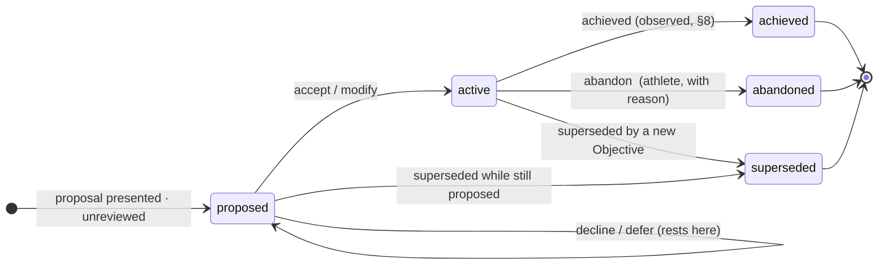

# PR3b — the live Objective: design

**Owner:** Mia
**Date:** 2026-09-23
**Status:** design for review. No code.
**Builds on:** `objectives-contract.md` (the entity is already specified there, §2 and §9; nothing is redesigned), `objectives-design.md` §11, PR3a as shipped (`ObjectiveProposal` under `objective-eval-spec/1.0.1`), ADR-015 (user ≠ athlete).

**What this PR is.** Not a persistence exercise. It is the governance boundary where a Nomila-generated `ObjectiveProposal` can become athlete-governed strategic state, and the only place that can happen. Everything below serves one outcome: the future Brain reads a set of live Objectives it can trust, because every one of them was either stated by the athlete or proposed by Nomila and explicitly accepted by her, with the original proposal and every decision preserved.

---

## 0. In plain words

**What Mia experiences.** After Nomila has done its work, it shows her a short list: the outcomes it thinks she should pursue, each with why, what it knows, and what she has told it that bears on it. For each one she does one of four things: accept it, change the wording to what she actually wants, decline it, or say not now. Her own goals she can add directly. That is the whole interaction, and it is infrequent: it happens when Nomila has something new to propose, not every day.

**What happens underneath.** The evaluator's proposal set is stored exactly as produced and never edited. Each proposal becomes a durable Objective row the moment it is shown to her, marked unreviewed. Her decision is an append-only event on that row, in her words where she gives them. Accepting or modifying makes the Objective live. Declining and deferring keep it as context. When Nomila runs again, it does not re-ask what she has already answered. The Brain, later, reads only what is live.

---

## 1. The transition, exactly

```
evaluator run (frozen, PR3a)
  → ObjectiveProposalSet  … persisted immutably, one row per run, with its digests
      → reconciliation (deterministic, §7) against the athlete's existing Objectives
          → for each proposal that is NEW:      an Objective row   origin derived · unreviewed · proposed
            for each proposal that REAFFIRMS:  no new row; an event on the existing Objective
            for each proposal that REPEATS a decline: no new row; an event, not shown (§7)
      → review queue = Objectives with disposition unreviewed
          → athlete decides (§2) → event → disposition and lifecycle move (§5)
```

**Materialise on presentation, not on acceptance.** A proposal she declines must exist as a row, because "she declined this" is strategic context the next run and the Brain both need. The contract already says so: `declined` rests at `lifecycle: proposed`.

**The proposal is never the entity.** `ObjectiveProposalSet` rows are immutable evaluator artifacts. An Objective references its proposal by `fromProposal { key, setAsOf, specVersion }` and copies the fields it needs at creation; nothing ever writes back.

**Correction to `objectives-design.md` §11 step 3d.** It said proposals would be persisted as ledger `RECOMMENDATION` entries. They will not. `RecommendationEntry` carries `proposedAction` and is the anchor for `MeasuredOutcome.adoption`; an Objective is an outcome, not an action, and adoption belongs to the Brain's Recommendations. Proposal sets get their own immutable table. Consequence, and it is the right one: no outcome ever carries `adoption` for an Objective.

---

## 2. What the four decisions mean

| decision | meaning, in one sentence | disposition | lifecycle | what is recorded |
|---|---|---|---|---|
| **accept** | "Yes, this is an outcome I am pursuing." | `accepted` | `proposed → active` | event; `reviewedAt`, `activatedAt` |
| **modify** | "Yes, but this is how I would put it." | `modified` | `proposed → active` | event with her text; `modifiedFrom` preserves the original verbatim |
| **decline** | "No." Optionally why, in her words. | `declined` | stays `proposed` | event with `said`; never re-surfaced while the decline stands (§7) |
| **defer** | "Not now." | `deferred` | stays `proposed` | event; re-surfaced at the next run, or when she returns to the queue |

**Accept activates.** There is no separate "start" step in v1. She chose it as a current goal; it is live. The contract's `accepted + proposed` combination remains valid for the one case that needs it: an Objective she creates herself and marks as not yet started (§3).

**Modify creates the Objective directly. It does not go back through the evaluator.** Three reasons, in order of weight:
1. Her modification is a *decision*, not an answer to be reinterpreted. The rule that athlete answers flow through canonical sources into State exists so that evaluators can *cite* them. A modification is not evidence for an evaluator; it is the athlete governing her own goal.
2. `desiredState` for a modified Objective becomes a `MeasuredValue` owned by `athlete_intelligence`, exactly as for an athlete-stated goal, because she stated it. Sending it through the evaluator would make Nomila the author of her words, which the contract forbids in so many words.
3. Cost and latency: a provider call to rephrase what she has already phrased.

**The boundary of modify.** She may change `desiredState` wording and `horizon`. She may not change `domain` or `success.quantified.statePath` under the same Objective: those change what the Objective *is*. Wanting that is decline + create (§3), or supersede (§6). The validator enforces it.

**Decline and defer are hers to revisit.** A declined Objective can later be accepted from its history; the events show both. Nothing is deleted.

---

## 3. Athlete-created Objectives

She can create an Objective with no proposal behind it: `origin: athlete`, `disposition: accepted` (her own goal arrives reviewed), `lifecycle: proposed` or `active` at her choice, `desiredState` as a `MeasuredValue` owned by `athlete_intelligence`, `currentState` absent-or-hers, `provenance.fromOpportunities` empty, `provenance.fromAthleteIntent` pointing at the event that created it. `fromProposal` absent. The contract already allows this; PR3b gives it a path.

This is also the escape for a modification that would change domain: decline the proposal, create her own, and the event on the declined one records `led_to: <new objective id>` so the lineage survives.

---

## 4. Immutable versus mutable on the durable Objective

| immutable after creation | mutable, by whom |
|---|---|
| `id`, `athleteId`, `version` | — |
| `origin` | — (established at creation, §4.1) |
| `provenance` (from opportunities, from athlete intent, current-state evidence) | — |
| `domain` | — |
| `fromProposal` | — |
| `currentState` as evaluated at creation | — (a later run may produce a new proposal; it never rewrites this) |
| `success.quantified.statePath`, `baseline` | — |
| `createdAt` | — |
| | `desiredState` wording: the athlete, via modify (original kept in `modifiedFrom`) |
| | `horizon`: the athlete, via modify |
| | `disposition`: the athlete or her authorised actor, via events only |
| | `lifecycle`: system, as a consequence of disposition or of supersession/abandon events |
| | `supersededBy`, `reviewedAt`, `activatedAt`, `closedAt`: system, append-once |

**No field is ever updated in place without an event.** The `objectives` row is a projection of its events for the mutable fields; the immutable fields are written once. A test rebuilds a row from its events and asserts equality.

### 4.1 Origin is established, never inferred

`origin` is derived deterministically at creation from what actually created the Objective, and then frozen:

| created by | origin |
|---|---|
| a proposal with ≥1 `fromOpportunities` and ≥1 `fromAthleteIntent` | `joint` |
| a proposal with `fromOpportunities` only | `nomila` |
| a proposal with `fromAthleteIntent` only | `athlete` (Nomila restated what she said; she still authored it) |
| the athlete, directly | `athlete` |

This is `deriveOrigin()` from PR3a, applied at one more point. The evaluator has no field to assert it; the athlete has no control to change it; a modification does not touch it (the contract's `joint` clarification). "Established rather than inferred" means exactly this: computed once from provenance by code, never guessed from content.

---

## 5. Disposition versus lifecycle: allowed transitions

Two axes, moved only by events. Disposition is what she said; lifecycle is where it is.



| from → to (lifecycle) | allowed on | who |
|---|---|---|
| `proposed → active` | disposition becomes `accepted` or `modified` | athlete / authorised actor |
| `proposed → proposed` | disposition becomes `declined` or `deferred`; or later flips between them or to `accepted` | athlete |
| `active → abandoned` | abandon event; disposition unchanged (she accepted it, then stopped) | athlete |
| `active → achieved` | an observed condition or the athlete marks it; v1: the athlete marks it | athlete (v1) |
| `active → superseded`, `proposed → superseded` | a new Objective cites this one as superseded (§6) | system, on creation of the successor |
| any terminal → anything | **never** | — |

**The central invariant, from the contract:** `lifecycle: active` requires `disposition ∈ {accepted, modified}`. A proposal cannot become her goal by sitting unread, by a timer, by the Brain, or by a reconciliation rule.

---

## 6. Supersession, not destructive editing

Strategic meaning lives in `domain`, `desiredState`'s substance, `success` and `provenance`. When any of that changes, the answer is a **new Objective** with `provenance.supersedes = <old id>`, and the old one gets `lifecycle: superseded`, `supersededBy = <new id>`, everything else untouched. Cases:

- The athlete modifies beyond wording (§2 boundary) → decline + create, or explicit supersede from the review surface ("replace this with…"), which does both in one event.
- A later evaluator run proposes a materially different outcome in the same territory → the new proposal is presented; if she accepts it, she is offered "does this replace X?" and only her yes supersedes X. Nomila never supersedes an active Objective on its own.
- She reshapes an active Objective's wording → modify, not supersede; `modifiedFrom` keeps the last wording, the events keep all of them.

Nothing is ever deleted or overwritten. `objectives` has no `DELETE` path.

---

## 7. Reconciliation: the rule that keeps review burden low

The next evaluator run sees State and the Opportunity map, not her decisions (the prompt is frozen and that is correct). So the same territory will be proposed again. Reconciliation is deterministic, runs at normalisation, and never touches the prompt:

For each proposal in a new set, find the closest existing Objective for this athlete in the same `domain` by desired-state similarity (the PR3a Jaccard, threshold `0.6`, one place, versioned). Then:

| closest existing Objective is… | do |
|---|---|
| none above threshold | **new** Objective row, `unreviewed`, into the queue |
| `active` (accepted / modified) | **reaffirms**: no row; event `reaffirmed_by_run` on the existing one; not shown |
| `declined`, within the decline window (`90 days`, a versioned parameter) | **repeats a decline**: no row; event `re-proposed_while_declined`; not shown. After the window, shown once as "Nomila still sees this; you said no on <date>" |
| `deferred` | **re-surfaces**: no new row; the existing one returns to the queue with the new proposal's rationale attached as an event |
| `superseded` / `abandoned` / `achieved` | **new** row, shown with the history of the old one attached |

Everything reconciliation does is an event; a run that produced no new rows still leaves a trace. This is the "when not to ask again" rule, made concrete and boring.

---

## 8. What the Brain may later treat as live

One reader, one definition, no interpretation:

```ts
/** Objectives the athlete is pursuing NOW. The only set the Brain may plan against. */
liveObjectives(athleteId): Objective[]   // lifecycle === "active" && disposition ∈ {"accepted","modified"}

/** Everything else, for context: declined, deferred, unreviewed, superseded, abandoned, achieved — with their events. */
objectiveHistory(athleteId): Array<Objective & { events: ObjectiveEvent[] }>
```

The Brain is not designed here. What is fixed here is that it gets **no other door**: it cannot read proposal sets as if they were goals, cannot read `unreviewed` as intent, and cannot read `declined` as anything but "she said no, on this date, in these words". Declined and deferred Objectives are context in exactly the way a `refuses` preference is context: they bear on a decision, they never create one.

---

## 9. Provenance of athlete-authored change

Every decision is an append-only event:

```ts
interface ObjectiveEvent {
  id: string; objectiveId: string; athleteId: string;
  at: string;
  /** ADR-015: the USER who acted, and the role their membership on this athlete gives them. */
  actor: { userId: string; role: "athlete" | "admin" };
  action: "presented" | "accept" | "modify" | "decline" | "defer" | "abandon" | "achieve" | "supersede"
        | "reaffirmed_by_run" | "re-proposed_while_declined" | "re-surfaced";
  /** Her words, verbatim, where she gave them. The one place prose belongs. */
  said: string | null;
  /** For modify: what changed. For supersede: the successor. For run events: the set that caused it. */
  delta: { desiredState?: { from: string; to: string }; horizon?: { from: unknown; to: unknown }; supersededBy?: string; setAsOf?: string; ledTo?: string } | null;
}
```

A modified `desiredState` is a `MeasuredValue<string>` owned by `athlete_intelligence`, `sourceMethod: "objective_event"`, `evidenceIds: [event.id]`. That is the same envelope every other athlete-stated fact uses.

**On whether decisions also write to `athlete_asserted`.** No. The `objectives` table *is* an athlete-owned canonical source, and a decision is not a free-text assertion; duplicating it would create two truths. Whether State should *project* live and declined Objectives (so the Opportunity evaluator can cite them) is a State 1.3 question, flagged in §13 and not decided here.

---

## 10. Minimum persistence and API

**Tables** (dev, behind `OBJECTIVES_V1`):

| table | rows | mutability |
|---|---|---|
| `objective_proposal_sets` | one per evaluator run: athlete, `asOf`, `specVersion`, `canonicalSha256`, `stateAsOf`, `opportunityMapAsOf`, the set as jsonb, the run record's diagnostics | immutable |
| `objectives` | one per Objective, fields per contract §9 | immutable fields written once; mutable fields are a projection of events |
| `objective_events` | append-only | insert only |

**API** (all under the caller's own athlete; `athleteId` from the session, never the body):

| route | does |
|---|---|
| `GET /me/objectives` | `{ queue: unreviewed[], live: liveObjectives(), history: objectiveHistory() }` |
| `POST /me/objectives/:id/decision` | `{ action: accept \| modify \| decline \| defer \| abandon \| achieve, said?, desiredState?, horizon?, supersedes? }` → one event, validated transitions (§5), returns the row |
| `POST /me/objectives` | athlete-created (§3) |

No route runs the evaluator. Runs stay a script behind the flag until a trigger is designed (a Brain question, §13).

---

## 11. The thinnest review surface

One screen, reachable from the Brand tab, shown only when the queue is non-empty; a badge otherwise. Per proposal, in this order and nothing else:

1. **Outcome** — `desiredState`, one sentence.
2. **Why Nomila thinks so** — `rationale`; the opportunities it came from, by their statements.
3. **What Nomila knows** — `currentState` with its citations rendered as the State lines they point to.
4. **What you told us** — `athleteStance` and the intent citations, labelled as onboarding choice or assertion, as State labels them.
5. **Horizon** — the period and its reason.
6. Four controls: **Accept · Change wording · Not now · No** — "Change wording" opens the sentence for edit, plus horizon; "No" and "Not now" offer an optional "why" box. Every control is a tap-to-confirm.

Not on the screen: confidence numbers, scores, ranks, the evaluator's key, anything execution-shaped. Mila can present the same list conversationally later using the same API; the screen exists first because the decision deserves a place she can return to, and because a chat draft would need the tap machinery this screen already is.

---

## 12. Review burden versus strategic agency

These are different things and PR3b optimises for the second. Objective review is **infrequent** (a run happens when Nomila has something new) and **consequential** (it decides what the Brain may plan against). It therefore warrants explicit, deliberate control, with the original proposal visible and her words recorded. Reconciliation (§7) removes the *repetition* that would make it a burden; it does not remove the decision. Recommendation review, later, will be frequent and lightweight, and must not pull Objective review down to its level: an accepted Objective is not a tap on a draft, it is her stating a goal.

---

## 13. Invariants (tests enforce)

**Tenancy.** T1 every read and write is scoped by the session's athlete; a borrowed id resolves to nothing. T2 the actor on every event is a user with a membership on that athlete; the role is recorded, not assumed.

**Validation.** V1 `active ⟹ disposition ∈ {accepted, modified}`. V2 `athlete` origin ⟹ never `unreviewed`, never `declined`. V3 `modified ⟹ modifiedFrom` present and `domain`, `success.quantified.statePath` unchanged. V4 no terminal lifecycle ever transitions. V5 `supersededBy` set ⟹ `lifecycle: superseded`, and the successor's `provenance.supersedes` points back. V6 the review surface and the API accept only the transitions in §5; anything else is a 4xx with the reason.

**Provenance.** P1 `origin` is derived by `deriveOrigin()` at creation and equals the value re-derived from provenance at any later time. P2 a proposal-derived Objective's immutable fields equal the proposal's, byte for byte. P3 the mutable fields of a row equal a fold over its events (the rebuild test). P4 every `said` is stored verbatim; nothing normalises it. P5 no code path deletes or updates `objective_proposal_sets` or `objective_events`.

**Reconciliation.** R1 a re-proposal of an active Objective creates no row. R2 a re-proposal inside the decline window creates no row and is not queued. R3 a deferred Objective is re-queued, not duplicated. R4 thresholds and windows are versioned constants in one place.

**Boundary.** B1 nothing under `services/intelligence/` imports a provider (existing test). B2 nothing in PR3b calls the evaluator from a request path.

---

## 14. Compatibility with what the evaluator already produced

The Run D / Run B / 1.0.1 artifacts store `{ state, map, record }` with `record.set` as an `ObjectiveProposalSet`. That shape is the row shape of `objective_proposal_sets`, so any of them can be loaded as a set. **They will not be.** They are experiment artifacts on frozen State snapshots; Mia's real flow starts from a fresh run against her current State, persisted as the first set, so that `fromProposal.setAsOf` resolves to a row that was actually presented. The contract fields PR3b copies from a proposal (`desiredState`, `currentState`, `domain`, `provenance`, `success`, `horizon`, `athleteStance`, `confidence`) are unchanged from PR3a; `objective-proposal/1.0.0` needs no bump.

---

## 15. Explicitly not in PR3b

- The Brain: its triggers, inputs, reasoning, Recommendation lifecycle. It gets `liveObjectives()` and `objectiveHistory()`, nothing more.
- Projecting Objectives into State (State 1.3). Needed before the Opportunity evaluator should see them; not needed for the review flow.
- A trigger for evaluator runs. Script behind the flag.
- Guardian or manager actors. `user_roles` has no guardian role today; Lilia's case is recorded, not solved: her account acts as `athlete`.
- `achieved` by observation. v1 is athlete-marked; observed achievement is a Results-layer question.
- Any ranking, priority or sequencing of Objectives.

---

## 16. Sequence

| PR | scope | proves |
|---|---|---|
| **3b-1** | contracts (`Objective`, `ObjectiveEvent`, transitions as pure functions), three tables, validators, `deriveOrigin` at creation, the events → row fold | V1–V6, P1–P5 on PGlite, no routes |
| **3b-2** | reconciliation (§7) with its versioned parameters; the three routes; `liveObjectives` / `objectiveHistory` | R1–R4, T1–T2, B2; a persisted set materialises a queue |
| **3b-3** | the review screen (§11), preview channel, flag on for Mia only | the surface exercises only the API's transitions |
| **checkpoint** | run the frozen evaluator once against Mia's current State, persist the set, present it, record her decisions, audit the events against the invariants and her words | the first live Objectives, and the Brain's input, exist and are hers |

---

## 17. Decisions in this page the reviewer may strike

1. **Accept activates immediately** (no separate start). Alternative: accepted-but-proposed until she starts. Chosen for burden.
2. **Modify never re-runs the evaluator** (§2). Alternative: revised proposal. Chosen for authorship.
3. **Materialise on presentation** (§1). Alternative: on acceptance only. Chosen so declines are context.
4. **Decline window 90 days**, similarity `0.6` (§7). Both versioned; the numbers are starting points.
5. **Proposal sets in their own table, not the ledger** (§1 correction). Alternative: ledger `RECOMMENDATION`. Chosen because Objective ≠ Recommendation and adoption belongs to the Brain.
6. **Screen before Mila** (§11). Alternative: chat first. Chosen because the decision deserves a place, and the tap machinery is the screen.
