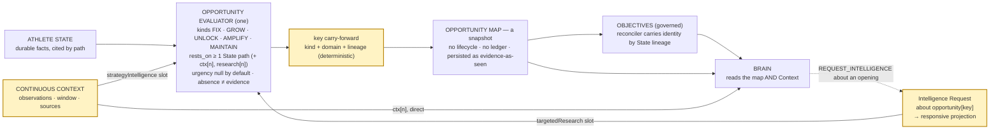

# Opportunity Intelligence pass 2 — design/repo/evidence checkpoint, 27 Sep 2026

**Controls:** `opportunity-map/1.0.0` + `opportunity-eval-spec/1.0.0` (digest `6bcf91ab…`, frozen); #638 for Context; #608 unchanged. No provider call, no implementation, no mounting. One offline analysis over the four recorded Mia maps (§7), pure, no code added.

**In plain words.** An Opportunity is Nomila's standing reading that there is something worth fixing, growing, unlocking, amplifying or keeping safe for her, backed by what Nomila knows about her. The world moves around that reading: a match is scheduled, a brand writes again, a deadline passes. Pass 2 asks how those movements should touch the reading — and the evidence says: rarely by creating an Opportunity, sometimes by adding evidence or urgency to one that already stands, most often by mattering to a single decision the Brain is making now, and quite often not at all. What must not happen is the map becoming a feed of events, or a second governed ledger beside Objectives.

---

## 1. Opportunity v1, as frozen

| piece | as recorded |
|---|---|
| kinds (verbatim) | **FIX** "Something present is actively costing them TODAY. Remove or repair it. The test: name the cost being paid now." · **GROW** "Something is weak or absent but buildable. Build it up from where it is." · **UNLOCK** "Something valuable ALREADY EXISTS and is not being used at all. Start using it. The test is binary: the asset is idle, not underperforming." · **AMPLIFY** "Something already works. Do more of it, or extend its reach." · **MAINTAIN** "Something works and is at risk from change or neglect. Protect it; change nothing." — "GROW and AMPLIFY are separated by where they start — weakness against strength"; "Do not map a state score to a kind." |
| domains | audience · content · positioning · athletic · commercial · relationships · owned_venture · impact · career · evidence (exactly ten) |
| evidence requirements | `rests_on` non-empty, each `{state_path, how}`; "CITE THE STATE"; "What is not in the state is not known"; **"ABSENCE IS NOT EVIDENCE OF WEAKNESS … Do not read a gap in our knowledge as a deficiency in them"**; "RETURNING FEW IS A VALID ANSWER"; no research in 1.0.0; external intelligence "may NEVER overwrite or contradict an athlete-specific fact" |
| judgments | impact / feasibility: level + claim ("a level without a claim is a score wearing a word"); **urgency null by default** ("a required urgency rating manufactures pressure that does not exist"); confidence ≠ attractiveness; no numbers, no prices, no prescribed action ("An opportunity that names a number has overstepped") |
| athlete voice | a preference or refusal bears on an opening, never erases it; an ambition can generate one and must be cited; never infer wants |
| gates | structural `validateOpportunity` / `validateOpportunityResponse` (kinds, domains, rests_on, claims, urgency shape, stance, **empty map valid**, duplicate keys refused); grounding `resolveStatePath` — an explicit grammar over the State forms deliberately exposed (findings/preferences/constraints keyed; `inbound[n]`, `dates[n]` positional); "resolution is existence, not truth"; both gates run, map non-null only when both pass |
| inputs | `OpportunityEvidence { stateBlock; strategyIntelligence?: null; targetedResearch?: null }` — State is the only evidence sent; both reserved slots declared, null |
| map | `OpportunityMap { athleteId, asOf, version, specVersion, stateAsOf, opportunities[], notes[], inputs[], overallConfidence }`; **an opening carries no timestamp, no status, no lifecycle** |
| identity | `key`: "short stable slug", **model-minted**, copied through unmodified; uniqueness enforced within one response only; the contract comment "stable across recomputes" is recorded as false in practice (`objectives-lineage-design.md` §28: "a fresh Opportunity run mints new keys"; `reconcile.ts:19`) |
| persistence | no `opportunity_maps` table; a map persists only as evidence-as-seen on `objective_proposal_sets.opportunity_map` (with `state_as_of` / `opportunity_map_as_of` consistency); **no reconciliation of a new map against a previous one exists** |
| consumers | the Objective evaluator (every key accounted for: `from_opportunities` or `consolidated` / `not_carried`); the Brain (`opportunity[<key>]`, read from the latest persisted set); the review surface (`fromOpportunities` resolved to statement + kind) |
| what "the map" means today | **a snapshot**: one evaluator's reading of one State at one `asOf`, cited by the Objective set that was judged from it. Not a ledger. Mia's three persisted sets all carry the same map (`asOf 2026-09-23T18:06`) — one run, reused |

## 2. Repo trace — what would have to change for pass 2, and what already exists

- The reserved slots are the seam (`OpportunityEvidence.strategyIntelligence` "refreshed periodically for everyone, never researched per athlete"; `.targetedResearch` "a question in, a versioned block out"). Both are declared, rendered nowhere, cited by nothing; the canonical text says "no research in 1.0.0".
- The grounding grammar is shared: the Brain resolves `ctx[n]` and `research[n]` with the same resolver family the Opportunity gate uses for State paths; extending Opportunity's grammar to those two forms is mechanical and gate-preserving.
- The Objective reconciler already carries identity across recomputes **by State evidence lineage** (tier A/B, Jaccard over `lineage.evidencePaths`, wording tie-break) — the one place cross-map continuity is solved, and it is solved for Objectives, not for openings.
- The Brain's `SUBJECT_KINDS` include `opportunity`, so an Intelligence Request can be raised *about* an opening (`opportunity[<key>]`) — the door pass 2's research slot would use.
- Nothing reads Context into Opportunity; nothing assembles Context from stores (#638 §10).

## 3. The contextual corpus, classified A–E (what Opportunity should have done)

A = creates an Opportunity · B = modifies an existing one · C = timing/urgency only · D = affects a particular Decision only · E = evidence with no strategic implication

| item | v1 behaviour (recorded) | verdict | why |
|---|---|---|---|
| schedule gap (two fixtures, 26-day home gap) | not seen by Opportunity; the Brain re-timed one decision on it | **D** (possibly C on `grow-instagram-posting-cadence`) | a quiet fortnight is not a strategic condition; at most it dates an existing GROW. It must never become capacity (#638 A6) |
| competition/calendar events (result, campus occasion, USWNT hook) | never cited by anyone | **E** | no implication for any standing opening; noise until a decision asks |
| StartX1 repeated inbound (3 threads, PAID) | **A in v1 (`amplify-inbound-startx1-interest`, AMPLIFY commercial)**; then falsely read as resolving the deferral | **A held — with a caveat**: repeated inbound is evidence of *commercial demand* (a strength to amplify), not of a partnership; the opening is right, the Objective it spawned ("an active, executed partnership") overreached (reconciliation audit) | demand is a durable-enough interpretation; the specific counterparty is Decision-relative |
| gorjana deadline / thread awaiting reply | not an opening; `commercialPosition.closedDeals` and `dates.inbound_deadline` in State | **D** (the Brain's REQUEST for what is owed) and **E** for the map | a deadline is an obligation; the *relationship* is `closedDeals`; nothing to fix/grow/unlock |
| INIU inbound, terms not stated | not an opening; State `pipeline` count | **D/E** — one more instance of the demand evidence above; no separate opening | a single inbound is not an Opportunity; several may be evidence of one |
| Northlight terms (controlled) | not seen; Existing Work + commercial projection | **D** | an open negotiation is work in motion, decided by the Brain; the positioning opening it advances already stood (`grow-academic-tech-partnerships`) |
| Yuwa pending proposals (controlled) | not seen | **E for the map; D for the Brain** (a plan was manufactured while waiting) | the AMPLIFY impact opening stands regardless; whether to do more now is the Brain's |
| TikTok series in production (controlled) | not seen; the Brain said NO_ACTION | **E for the map** — the UNLOCK still stands while work runs (§8) | the strategic condition persists until the asset is in use; work-in-progress is not use |
| public earnings / fame (Ronaldo) | State findings; in Ronaldo's map an AMPLIFY was reasonable | **B at most** (evidence on a strength) — never a pricing basis | the failure was Brain-side interpretation, fixed by invariant 1 |
| brand / profile evidence (gorjana site, no dated drop) | not seen | **E** (absence); could be **B** on a commercial opening when a brand's activity is positive | absence is not evidence (§13) |
| cultural / market moments (#608 has no concrete fixture beyond the block's `sport_wide_hook`) | never cited | **C or E** — may date an existing opening's urgency, never creates one alone | an event is not a condition |
| athlete cadence assertion (via the seam) | State would read it only by field regex (it does not) | **B** on `grow-instagram-posting-cadence` (feasibility claim) if it entered State; otherwise **D** | her stated capacity bears on feasibility; it is not a new opening |
| `unlock-adidas-historical-performance-data` (UNLOCK **evidence**) | v1 opening, carried into an Objective, declined by her | **not an Opportunity — an Intelligence Request** (need `demonstrated_valuation`, class connected/athlete) | a gap in Nomila's knowledge is not a strategic condition of the athlete; the reconciliation audit reached the same reading ("evidence acquisition promoted to the Objective layer") |

**Count:** of the twelve context items, none is a clean A; one A already existed in v1 and held; two are B; two are C; the rest are D or E. The corpus supports #638's finding from the other side: **context mostly matters to Decisions, occasionally to an opening's evidence or timing, and almost never mints an opening.**

## 4. The semantic job of an Opportunity

> **An Opportunity is a durable strategic interpretation that there is something worth fixing, growing, unlocking, amplifying or maintaining for the athlete — supported by evidence — not merely an event, signal, opening, task or Decision.**

Tested against the corpus: it survives every row of §3, and it *explains* the two v1 misfires — `unlock-adidas-…` fails "for the athlete" (the thing to unlock is Nomila's knowledge), and the StartX1 **Objective** failed "durable interpretation" (a specific partnership is a Decision, the demand is the interpretation). It also explains the AMPLIFY colour problem of the first run (§5): "supported by evidence" is the clause the spec's "CITE THE STATE" protects, and the claim, not the citation, is where it slipped. The five kinds stay; each already carries its test. One refinement recorded, not applied: **the `evidence` domain names a knowledge gap, which the vocabulary now expresses better as an Intelligence Request** (§14, candidate for 1.1.0 — keep the domain until then; the Brain may raise the request either way).

## 5. Positive signals must not manufacture deficiency

Where the failure actually occurred: **the Objective evaluator**, seven claims across four athletes, all on AMPLIFY-derived proposals ("lacks a diversified programming matrix", "does not systematically leverage"), because `currentState` must differ from `desiredState` and the evaluator invented a shortfall to have a gap to close — a `objective-eval-spec/1.0.3` candidate, parked deliberately so the 1.0.2 rerun's attribution stayed clean. **The Opportunity spec already forbids it** ("absence is not evidence of weakness"; AMPLIFY starts from strength; "do not map a state score to a kind"), and Run 3 pinned that none of its AMPLIFYs was a paraphrase; the first run's overreach was *colour beyond State* (a scholar-athlete narrative with nothing academic in State), a citation-versus-claim gap, not a manufactured deficiency.

For pass 2 the rule to carry into the text when it is bumped (§14 P4): **a positive contextual or world signal supports AMPLIFY or MAINTAIN of something State shows working, or GROW of something State shows weak; it never asserts a weakness State does not carry.** Brand interest supports amplifying demand without claiming she lacks commercial strength. No amendment to 1.0.0 now: the recorded failure is Objective-side and its fix is already a named candidate.

## 6. Event versus Opportunity — the minimum transformation

A context item becomes (or touches) an Opportunity only through an **interpretation that**: (1) passes one kind's test in its own words (a cost paid now · a buildable weakness · an idle asset · a working thing to extend · a working thing at risk); (2) **rests on at least one State path** — a durable fact about her; a context item may be cited beside it, never alone; (3) **outlives the event** — if the statement would be false the day after the event passes, it is timing (C) or Decision context (D), not an opening.

| example | result |
|---|---|
| the Olympics occurring | nothing by itself (E); with State showing her selection and a working narrative → MAINTAIN/AMPLIFY *of the narrative*, dated by the Games (urgency claim) |
| tournament qualification | may create one **if** State carries the strategic implication (a selection, a new competition context) — it is then a State fact first (`identity.competitionContext`, `athletic` domain), and the opening rests on it |
| a posting deadline | never (D: an obligation the Brain weighs) |
| a new inbound | never by itself (D/E) |
| repeated inbound | evidence of commercial demand → may support AMPLIFY commercial (A held in v1) — rests on `inbound[n]` + `pipeline`, both State |
| a cultural moment | may date an existing opening (C) or a Brain decision (D); never mints one alone |

## 7. Identity over changing context — inspect before inventing

**What the record shows.** Keys are minted by the model and are not stable: the four recorded Mia runs produced four different key sets for what is largely the same athlete (Adidas evidence under three names; Yuwa under two; audience under three). Offline, the best evidence-lineage match between openings across runs (Jaccard over `restsOn` paths) is decisive only for the pair with identical citations (Yuwa: 1.00) and otherwise sits at 0.2–0.5 **including cross-kind, cross-domain matches** — two run-c openings with the same three findings both match run-d's Yuwa opening at 1.00. Lineage alone cannot identify an opening; State paths are too coarse and the same evidence legitimately supports different readings.

**Therefore, for the current architecture:**

| when context changes | what Nomila does | mechanism |
|---|---|---|
| same opening, new supporting evidence (B) | the opening is re-emitted with the new citation beside the State paths | the evaluator, on recompute (pass 2 input); **same map, new snapshot** |
| timing/urgency changes (C) | `urgency {level, claim}` on the re-emitted opening, dated by the event | the evaluator; null stays the default |
| a genuinely new condition (A) | a new opening in the new snapshot | the evaluator |
| an opening no longer supported | **absent** from the new snapshot — no `superseded`, no `closed`, no event | the map is a snapshot; consumers keep their own lineage (Objectives cite the set they were judged from) |
| nothing relevant changed | re-emitted unchanged | the evaluator |

**No Opportunity lifecycle, no Opportunity governance, no Opportunity ledger.** The durable governed thing is the Objective, and the Objective reconciler already handles continuity across recomputed maps by State lineage with a wording tie-break — the only place identity across snapshots is needed, and it is solved there. **One deterministic addition is worth measuring** (§14 P5): *key carry-forward* — when a re-emitted opening has the same kind and domain as one in the previous map and its lineage matches at or above the reconciler's threshold, reuse the previous key, so consumers can tell a persisting opening from a new one as the contract intended. It is a normaliser step, not a state machine; on the four recorded runs it would have carried Yuwa and Adidas and nothing wrong — and it is exactly as coarse as its evidence, so it must be measured, not trusted.

## 8. Relationship to existing work

Opportunity v1 does not read Existing Work (its only input is State; pipeline and closed-deal *counts* reach it through State). The corpus says that is right: **a strategic condition exists** (an idle TikTok channel; cooling Instagram cadence; academic-tech positioning to grow) independently of whether **Nomila should initiate additional work now**. 1B pinned the split: with the TikTok series in production the UNLOCK still stood and the Brain answered **NO_ACTION**, citing it; with the Northlight sheet pending the positioning GROW stood and the Brain routed a **direct action** on the work item. The opening did not cease; the work changed what to *do* about it. An opening ceases only when the condition does — the channel is in use, the cadence is no longer cooling — which State will show and the next snapshot will omit. Existing Work stays a Brain lens; it does not enter Opportunity.

## 9. Relationship to Objective

Preserved: an Opportunity **may support** an Objective proposal (`fromOpportunities`), never becomes one. A temporary event: may add evidence or an urgency claim to an opening (B/C) → the Objective evaluator sees the new map on its next run → the reconciler reaffirms the existing Objective (tier A/B) rather than proposing again; it never touches an Objective's horizon directly; the Brain may weigh the event's timing for a Decision on that Objective (D); by itself it produces **no Objective change**. The StartX1 case is the recorded warning: an opening about *demand* plus a broad intent was enough for the Objective evaluator to propose a *specific* partnership — the overreach happened between Opportunity and Objective, and the deferral discipline (L2) is what held it.

## 10. Relationship to the Brain

The Brain receives both **the map** (strategic interpretation, cited `opportunity[<key>]`) and **Context** (situational evidence, cited `ctx[n]`), and the corpus needs both: the schedule gap affected a Decision that no opening could carry, while every RECOMMEND rested on an opening. Removing Context from the Brain would force D-class facts through the map (manufacturing openings); removing the map would make the Brain re-derive strategy from State every run (Stage 1 showed it re-emits the Opportunity layer already). Smallest correct architecture: **both lenses, distinct provenance, distinct role** (#638 §9).

## 11. Pass-2 implementation alternatives

| option | shape | verdict |
|---|---|---|
| **A** | the same evaluator, receiving Context through the reserved slots (`strategyIntelligence` = shared world context; `targetedResearch` = the responsive projection of an evidenced request raised *about* an opening) — `opportunity-eval-spec/1.1.0` by ceremony; grammar extended to `ctx[n]` / `research[n]` | **the designed seam; one executor; one map** |
| B | a deterministic amendment pass over the existing map (add citations / urgency from context items) | cannot judge strategic implication deterministically (§6 is a judgment); **but** the identity carry-forward of §7 is deterministic and belongs here |
| C | a separate Opportunity Intelligence producer merged into one map | a second strategic system; rejected (#608 D1, "one Brain" reasoning applies one layer up) |
| **D** | **A + the deterministic key carry-forward as a normaliser step** | **recommended** — the smallest thing the repo supports: no new contract, no new table, one spec bump when built, one pure function beside `normalise` |

"One Opportunity Map" stays the default; nothing in the corpus needs two.

## 12. Provenance and gating

A context-derived opening must show `context/evidence source → interpretation → opening`: it does, if (1) `rests_on` **still requires at least one State path** (a context-only opening is refused — an event alone is not a condition); (2) `ctx[n]` and `research[n]` citations resolve by the same explicit grammar the Brain uses (index bound; for research, `requestedBy.requestId` attributable, the request's subject being `opportunity[<key>]` or the athlete); (3) the persisted snapshot records the Context block and any research block byte for byte beside `state_snapshot` (the proposal-set discipline). The existing gates suffice once the grammar admits the two forms; nothing weaker than v1 is introduced, and "a level without a claim" and "no numbers" carry over unchanged.

## 13. Absence semantics

Carry the v1 rule across the boundary and make its scope explicit: *no event observed ≠ no event*; *no inbound in connected data ≠ no commercial interest*; *no campaign record ≠ no campaign*. A Context block is complete only within its stated `window` and its named sources; an absence statement in it (Stage 1's `ctx[3]`, `ctx[5]`) is an observation about those sources, never negative evidence for an opening. Recorded test for 1.1.0: a block whose only StartX1-relevant content is "no new inbound in the window" must leave `amplify-inbound-startx1-interest` untouched, not downgrade it. The Brain handled both absence statements correctly in Stage 1; the Opportunity text must say the same when it can see them.

## 14. Exact proposed amendments — none to 1.0.0; all for the 1.1.0 bump when pass 2 is built

| # | where | proposal | evidence |
|---|---|---|---|
| P1 | `OpportunityEvidence` | keep both slots; define `strategyIntelligence` as the continuous Context block (#638 §5 shape) and `targetedResearch` as the responsive projection of an evidenced Intelligence Request about an opening; grammar admits `ctx[n]`, `research[n]` | #608 D7, #638 §6 |
| P2 | spec text | `rests_on` must include ≥ 1 State path; context is cited beside it, never alone | §6 |
| P3 | spec text | absence rule extended to Context and its window (§13) | Stage 1 §6 |
| P4 | spec text | positive-signal rule (§5): AMPLIFY/MAINTAIN from external demand or moments; never an asserted weakness State does not carry | objective-validation-cohort §3.2 (Objective-side), first-run §AMPLIFY |
| P5 | normaliser (code, not spec) | deterministic key carry-forward by kind + domain + lineage threshold; replace the contract comment "stable across recomputes" with what is true and what carries | §7 |
| P6 | vocabulary (candidate, later) | `evidence`-domain openings expressed as Intelligence Requests (typed need) rather than strategic openings | §3 last row, reconciliation audit |
| — | kinds, domains, gates, urgency default, athlete voice | **no change** | corpus |
| — | `objective-eval-spec/1.0.3` | the parked AMPLIFY-deficiency paragraph stands as recorded; not this boundary's to apply | cohort §3.2 |

## 15. Canonical architecture, zoomed in on UNDERSTAND → Opportunity

Highlighted: the two evidence slots filled by the existing Context lens and the existing request loop; the deterministic key carry; nothing else moves. The main loop is unchanged; Context still reaches the Brain directly.

## 16. What remains empirical

- Whether the evaluator, shown a Context block, creates no more openings than §3 predicts (0–1 for Mia's block) and dates the right ones.
- The key carry-forward threshold on real recomputes (the four recorded runs are the only data; two are on an older State).
- Whether `research[n]` about an opening ever downgrades or drops one (the "validation" reading of pass 2 in `targeted-intelligence-audit.md` §51) — unexercised.
- The absence test of §13.
- Whether the `evidence` domain survives once requests are the vehicle (P6).

## 17. Smallest forcing experiment, if needed

Not needed to adopt §14's direction. When pass 2 is built: **one Opportunity run for Mia** under `opportunity-eval-spec/1.1.0` (by ceremony) with the same State as run-d and the seven-item Context block in the `strategyIntelligence` slot, compared with run-d — openings created / dated / unchanged, citations of `ctx[n]`, the absence test, and the carry-forward applied offline. One call. Not now.

## 18. Not done

No provider call. No implementation (the §7 analysis was a scratch computation over recorded artifacts, not code). No mounting. No Deals, Rate, Objective, Recommendation, Campaign/Studio or brand-relationship change. No repeatability matrix. `opportunity-map/1.0.0` unchanged; #608 unchanged; #638 is the Context checkpoint; #570 untouched.

---

## 19. Review outcome (27 Sep 2026) — accepted; 1.1.0 ceremony and one treatment call

**Accepted:** Context is not a second Opportunity generator; the map remains a strategic snapshot (no ledger, lifecycle, disposition, state machine, governance or supersession machinery); model-minted keys are not identity and evidence lineage alone is not identity either; **key stabilization across adjacent snapshots** (same athlete · kind · domain · sufficiently strong lineage) is continuity for readability, never identity, with no lifecycle built on it; the semantic job adopted; the Event → Opportunity test adopted experimentally (the *interpretation* must outlive the event, not the context); existing work does not erase an Opportunity; the manufactured-deficiency fix stays Objective-side (1.0.3 candidate); pass 2 = one evaluator → one map with the reserved lenses filled, then deterministic key stabilization; grammar extended only as needed with the State-path requirement retained; absence semantics carried (MISSING ≠ NONE).

**Done after review:** the ceremony to `opportunity-eval-spec/1.1.0` (digest `b6883c24…`) and `opportunity-map/1.1.0`, with five of the six amendments (P6 deliberately deferred); parity green; 22 recorded artifacts gate identically; one treatment call against run-d as control — `docs/audits/opportunity-1.1.0-pass-2-treatment.md`. **Pass 2 supported on the question asked:** six of seven context items produced no opening; the one used (brand activity) supported a State-grounded AMPLIFY of an existing relationship and dated it; two keys carried unambiguously, three new keys stood rightly. Criterion 4 (epistemic gaps are not Opportunities) is **not met by design**: the `evidence`-domain opening persists until P6 is decided — the next decision this boundary needs.

## 20. Closure (27 Sep 2026, reviewed)

**Opportunity Intelligence pass 2 is closed at the experimental architecture level.** The forcing experiment (#640) supports the architecture. Established: **one evaluator, one map** — State + Athlete Intelligence + Context + relevant responsive evidence → one Opportunity evaluator → existing gates → normalisation → conservative key stabilization → one Opportunity Map; no second Context-driven generator. **State grounds; Context supports** — six of seven Context items did nothing; the one cited (brand activity) supported a State-grounded AMPLIFY and contributed urgency. **Events are not Opportunities** — fixtures, result, occasion, friendlies and the control stayed inert. **Key stabilization** accepted experimentally with explicitly narrow semantics: continuity across adjacent snapshots, not durable identity; the decisive evidence is the 0.33 candidate that did *not* carry — a new key is preferred over false continuity; no lifecycle or governance on stabilized keys. **Variation**: uncited differences between arms are not Context effects (one sample per arm, temperature 1.0); only cited, context-grounded changes belong to the conclusion. **Gorjana overreach** recorded (campaign language on an ongoing collection); not tuned from one occurrence — Context supported urgency and did not ground the opening. **Criterion 4** does not invalidate pass 2: the evidence-domain opening is the deliberately deferred P6 question, a pre-existing semantic issue pass 2 preserved. No further Context call; no repeatability matrix. Next: P6 (`opportunity-p6-knowledge-boundary-checkpoint.md`).
