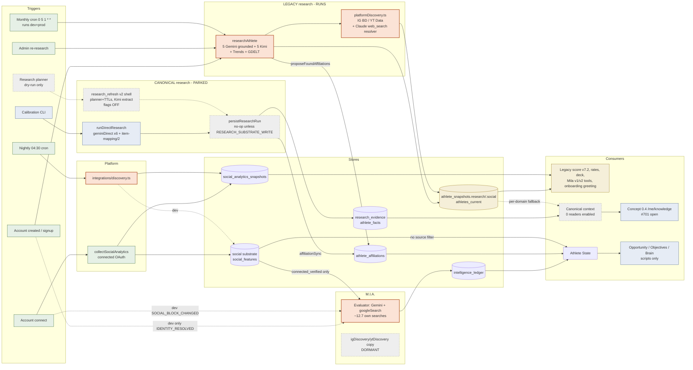
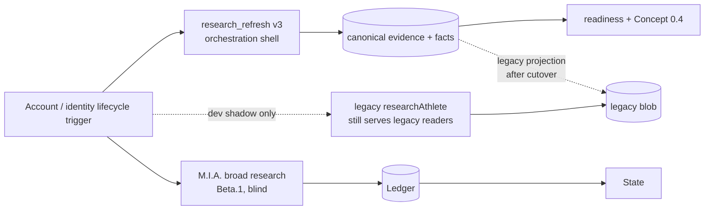

# Research & intelligence acquisition architecture — investigation + target

**Status:** **Architecture LOCKED 30 Sep 2026.** Step 1 hardening proceeds with all behaviour-changing flags off and
provider-free tests. Any implementation discovery that contradicts a locked assumption is reported before the design
changes.

D1–D13, R-a…R-f and the O3/O5 decisions are recorded in §13 (final decisions, 30 Sep 2026). This document itself is
design only: no code, flag, provider or database change comes with it, nothing is retired by it, and production
behaviour does not change.
**Baseline:** origin/main `59e95769` (30 Sep 2026). Concept 0.4 read from `feat/concept04-slice1` (#701) and
`fix/concept04-knowledge-freshness` (#707). Since then #706, #708 and #701 have merged (main `e44c9c6a`); line references
remain at the `59e95769` baseline unless noted, and the merges do not change any locked decision.
**Marks:** **V** = verified in code/config at the cited line · **D** = stated in a repo doc and not re-measured here ·
**I** = inferred. Paths are relative to the repo root. Line numbers are at `59e95769` unless a branch is named.

---

## In plain words first

**What an athlete experiences today.** When an athlete signs up, Nomila looks her up on the web. Later it tells her
what it found, gives her a score and rates, and Mila talks about her using that material. On dev, a second,
completely separate system (M.I.A.) looks her up on the web again to judge her marketability. The two lookups do not
share notes. They can land on different people with the same name. In one dev case one found a Malvern Prep player
and the other found a goalkeeper in Goa (D, `docs/plans/mia-identity-anchoring.md:20-25`). Once a month Nomila redoes
the first lookup for everyone, whether or not anything changed.

Nomila also built a better, careful way to research an athlete. It records every source, knows how fresh each fact
is, and never lets a web guess outrank what the athlete said or what a contract proves. That careful system has only
been run by hand on 35 test athletes. No real account creation, account connection or schedule reaches it. The "What
Nomila knows" screen (#701) is the first surface built to show it.

**What the team experiences.** There are three live research paths (legacy, M.I.A. and a Claude handle check) and two
parked ones. There are three copies of the Instagram/YouTube lookup code. There are two social pipelines that can
disagree about the same athlete. The honest answer to "where does Nomila's knowledge about her come from?" is "it
depends on which screen you look at".

**What this document proposes.** Keep two tracks and draw a clean line between them:
- **Knowledge.** What Nomila knows and why. Canonical evidence and facts are the knowledge substrate. One governed
  orchestration shell runs the research that fills them.
- **Intelligence.** What that means commercially. M.I.A. keeps researching and judging on its own, and receives
  Nomila's knowledge only through explicit, versioned admissibility contracts.

Move real product triggers off the legacy lookup and onto the careful one, in stages. Then retire the legacy path
against named exit criteria, so that no research system survives indefinitely by accident.

**Transitional and target are different things.**
- **Transitional (validation).** During validation, the careful lookup and M.I.A.'s broad lookup run side by side,
  and on dev the legacy lookup also runs in shadow. That costs more per athlete than today. It is accepted only as a
  validation condition, not as the end state.
- **Target.** Authoritative and canonical information is acquired once where that is appropriate. Consumers receive
  governed evidence under their own contracts. M.I.A. keeps independent research only where it demonstrably adds
  intelligence value, and Beta.2 must show that by experiment.

**Research supports the new product. It does not encode today's onboarding.**
- When an athlete account is created, or identity information becomes available, appropriate research can **start**.
- Results persist **progressively**, and every consumer can read an honest per-domain research status: not
  requested, queued, running, or settled with an outcome (found, researched and nothing found, failed), plus an
  explicit identity-resolution state.
- Whether any screen waits for research, and for what, is a decision for the new onboarding and UI (Concept 0.4). It
  is not a decision for this document (§9.4).

---

## Not disturbed by this document

| Decision | Status (at 30 Sep) |
|---|---|
| #701 is the Concept 0.4 knowledge read model ("What Nomila Knows") | **merged** (e44c9c6a), stands |
| #707 fixes research freshness in that view | open (rebasing onto main), stands |
| #702 signal mapping (ledger components ↔ evaluator judgements) | **merged**, stands |
| #706 explicit evidence strength (cited source actually retrieved) + State 1.5.0 | **merged** (b907c073), stands |
| #708 documents the M.I.A. grounding limitation | **merged** (5da7533b), stands |
| Evaluator spec `blind-eval-spec/0.2.1`, digest `167e6c50…` (`marketabilityBeta1EvaluatorSpec.ts:511`) | **frozen** |
| Legacy v7.2 marketability and legacy `story_arc` stay excluded from Concept 0.4 | stands |
| Beta.2 is its own decision (PR #704) | stands; §10 lists only interface implications and the experiment design |
| No Kimi 60 s timeout fix | stands; the Kimi stage leaves the normal path instead |
| Mia is not re-run until this target is agreed | stands; §12 says how and when |

## Approved core (user disposition, 30 Sep 2026)

| Layer | Owns | Approved shape |
|---|---|---|
| **Knowledge** | What Nomila knows, and why | research → evidence → deterministic canonicalization → facts / context |
| **Intelligence** | What it means commercially | M.I.A. research and reasoning → frozen contract → Ledger |
| **State** | What is strategically true now | reads the Ledger, private stores, the substrate and affiliations through declared admissibility |
| **Opportunity / Objectives / Brain** | What to pursue and do | read State |
| — | — | **No M.I.A. write-back** into canonical knowledge |

**What ADR-017 rejected.** ADR-017 rejected the deterministic conversion of research facts into **qualitative
sub-signal (score) values**: it "supersedes the deterministic signal-conversion design … for qualitative sub-signals"
(`ADR-017…md:3-4`).

It did **not** reject canonical evidence, and it did not reject deterministic fact resolution:
- "Not because deterministic scoring is wrong. Because the conversion required data we do not have" (`:29-30`).
- "Deterministic conversion remains correct where the inputs are genuinely quantitative and anchored" (`:62-63`).
- Nothing in the record retires `athlete_facts`, the registry or the resolver (B §2) (V).

### Principle: acquisition authority and interpretation authority are different

Each source is authoritative for its own kind of information:

| Source | Authoritative for |
|---|---|
| OAuth | the connected account and its platform metrics |
| Athlete confirmation | certain identity and self-knowledge |
| A signed contract | a commercial relationship |
| Canonical research | cited public evidence, where stronger sources do not exist |

None of them is automatically authoritative about **marketability**. M.I.A. owns that interpretation.

**Rule:** acquire from the strongest appropriate source → preserve authority and provenance → let the appropriate
intelligence system interpret it.

**It prevents two mistakes:**
1. "M.I.A. is intelligent, so let it reacquire everything."
2. "Canonical facts are authoritative, so turn them deterministically into marketability." (This is what ADR-017
   withdrew.)

The principle applies beyond research: commercial intelligence, Studio, Nomi identity, strategy and Mila all
interpret governed evidence. None of them acquires its own weaker copy of it.

### Invariant: identity before identity-dependent work

Any identity-dependent intelligence or research operation must not proceed against an unresolved or ambiguous athlete
identity, unless that operation is itself an identity-resolution operation.
- Q1 (identity resolution) may run.
- Q2–Q6 may not run until the gate passes.
- **No identity-dependent M.I.A. trigger may evaluate an unresolved or ambiguous public identity.** This covers every
  trigger: `IDENTITY_RESOLVED` at account creation, `SOCIAL_BLOCK_CHANGED` after a connect, admin/user refreshes, and
  any future trigger.
- The exact deferral and coalescing behaviour (for example, holding a `SOCIAL_BLOCK_CHANGED` request until identity
  resolves, then running once) is implementation design.
- R-a, which orders the account-creation M.I.A. evaluation after Q1, is one application.
- **Cost:** a wrong-namesake athlete still pays for identity resolution (Q1 ≈ $0.07). What it avoids is Q2–Q6
  (≈ $0.37) and the M.I.A. evaluation (≈ $0.21).

---

## Reconciliation of the four investigations

The four findings files (A current state, B history, C web research, D platform/private) and the earlier
`research-path-classification` disagree in places. Each conflict was spot-checked in a clean worktree at `59e95769`.

| # | Conflict | Resolved to | Evidence |
|---|---|---|---|
| R1 | Does production M.I.A. read `research_evidence` social handles? The classification, B and D say yes; A and C say no. | **No (A/C).** The discovery branch is dormant at runtime. | `marketabilityBeta1Snapshot.ts:110-118` (`discovery` defaults off), `:144` gate; `marketabilityBeta1Orchestrator.ts:89-94` passes only `{triggerDetail, now}`; grep finds no non-test `discovery: true` (V) |
| R2 | Legacy query count: "4" (file header) or 5? | **5** in code. The header is stale. | `researchAthlete.ts:4` says 4; `buildQueries` has Profile+Social, Commercial+Brand, Performance+Press, Media Assets, Social Handles (`:186-218`) (V) |
| R3 | Is Kimi only on the transitional path? | **No.** Legacy uses `kimiInstant` too. | `researchAthlete.ts:13`, `:340` (V) |
| R4 | Does any production-triggered research reach `athlete_facts`? | **No.** Dual-write is off, and persist is a no-op with the flag off. | `researchAthlete.ts:768-770`; `persist.ts:95`; `RESEARCH_SUBSTRATE_WRITE=false` dev:252-253, prod:268-269 (V) |
| R5 | D §9 lists M.I.A. as a consumer of `research_evidence` brand mentions. | **Wrong.** Production M.I.A. reads no research substrate (R1). | as R1 (V) |
| R6 | The 3-way discovery duplication (D) is "live in production" for M.I.A. | **Code-level, not runtime.** The M.I.A. copy is dormant. The legacy and cron copies run. | D addendum; R1 (V) |
| R7 | Maximum direct-path attempts: 12 (CLI text) or 18? | **18** (6 queries × (1 + `geminiRetryMax` 2)). | `policy.ts:59`; CLI `runDirectResearch.ts:43` undercounts (V) |
| R8 | `unionResearch`: "union across runs" or "richest run wins"? | **Richest single run per list wins.** A set union was tried and removed. | `researchMerge.ts:12-17` (V) |
| R9 | Spearman 0.887 or 0.889? | Both appear. ADR-017/SUPERSEDED/README use 0.887; commits use 0.889. **Quoted here as 0.887.** | B §Inconsistencies (V) |
| R10 | `collectDiscoveryAnalytics.ts:9-11` says "not yet wired to a cron". | **Stale comment.** It runs inside the 04:30 cron. | `server/index.ts:2087` (V, via D) |
| R11 | Was the Claude `web_search` handle resolver counted as web research? C omitted it. D names it. | **It is web research** on the live legacy path. It is added to the inventory. | `socialWebResolver.ts:1-28` (Claude Haiku 4.5 + `web_search`); called from `platformDiscovery.ts:301`; `ANTHROPIC_API_KEY` bound dev:85-88, prod:149-152 (V). Key validity unknown (I) |
| R12 | "35 athletes have facts, all via the direct path." | **D, not re-measured.** | `docs/audits/nomila-e2e-audit/04-context-and-world.md:64-65`; classification count of 490 `gemini_direct` payloads (D) |
| R13 | Direct-path "gate before spend" hazard: C marks it INFERRED. | **Verified in code.** The run row is opened and providers are called before the persist gate. If persist returns `null`, the row is never closed. | `directResearch.ts:95` (insert `running`), `:110-128` (calls), `:153-158` (null ⇒ "failed" returned, no row update) (V) |
| R14 | "The Meta token is unusable for Business Discovery" (`Snapshot.ts:111-113`). | **Possibly stale.** `DISCOVERY_IG_TOKEN`/`_BUSINESS_ID` are bound in both yamls. Validity is **unknown**, because checking it needs a provider call. | D addendum (V bindings; validity unknown) |
| R15 | "Legacy onboarding blocks the athlete until research completes." | **Not quite.** The app is **not** gated while research runs. The athlete is pulled into a full-screen greeting only once the run parks on `greet`. | `client/hooks/use-onboarding-run.ts:1-9`, `:20-21` (polls 8 s × 20); `client/App.tsx:83-101` (V). See §9.4 |
| R16 | "Onboarding v3 already does an identity gate before research." | **It is a different identity.** v3's `identity_confirmed` checks *account* ownership (an active self-membership), not *which public person* the web results describe. | `onboarding.ts:205-216` (`selfMembershipFor`) (V) |

**"Prod" in this document** means the configuration in `gcp/cloud-run-prod.yaml`. Whether a production service serves
real athletes today is outside this investigation. Project notes describe the single live environment as effectively
dev (I).

---

## 1. Executive summary — what is actually wrong today

1. **The research that actually runs is the one the architecture meant to retire.**
   - Account creation, admin re-research and a monthly sweep all run legacy `researchAthlete` in both environments
     (`onboarding.ts:70`, `:146`; `admin.ts:250-253`; `index.ts:2234-2240` → `reEnrichAthletes.ts:60`) (V).
   - It uses 5 Gemini grounded queries and 5 Kimi extractions. It keeps no raw evidence, does no identity check and
     writes an uncited JSON blob (`athlete_snapshots.research`) (V; C §4.1).
2. **The canonical knowledge system is built but unreachable.**
   - `runDirectResearch → geminiDirect → item-mapping/2 → persistResearchRun` is the spec-grade path. Its only caller
     is a calibration CLI (`server/scripts/calibration/runDirectResearch.ts:52`) (V).
   - The research_refresh v2 orchestration shell is gated off in both environments and bound to Kimi
     (`skills/researchRefresh.ts:15-17`; `config.ts:44-46`) (V).
   - **No production-triggered research reaches `athlete_facts` / `research_evidence`** (R4).
3. **Nobody reads the canonical context in production.**
   - Every gated reader is off (`CANONICAL_CONTEXT_READERS=""`, `CONTEXT_SHADOW=false`, both yamls) (V).
   - Only #701 (merged e44c9c6a; Concept 0.4 client flag) reads it, and it bypasses the flag.
   - The builder also falls back to the legacy blob per domain (`context/build.ts:65-108`) (V).
4. **Two independent web researches of the same person, with no shared identity.**
   - On dev, account creation pays for legacy (≈ $0.20, I) plus M.I.A. (≈ $0.21 mean, D). They can resolve different
     namesakes.
   - The prod account-creation path requests no M.I.A. evaluation (`auth.ts:254-257`) (V).
5. **M.I.A. is deliberately blind to Nomila's knowledge.**
   - Its only Nomila input is name, sport and connected social features (`marketabilityBeta1Snapshot.ts:126-172`) (V).
   - That was right for Beta.1 (ADR-017).
   - It also means M.I.A. never sees an athlete-confirmed team, a signed contract or a confirmed deal.
6. **Platform data is fetched by three copies of the same code, and two social pipelines can disagree.** (V; §8)
7. **Research reaches State only through a side door:** `athlete_affiliations`, which legacy writes
   (`researchAthlete.ts:727`) and canonical writes (`persist.ts:239`) through different code (V).
8. **Downstream reality.**
   - Opportunity, Objectives, the Brain and the outreach planner have **no production trigger**. Their only callers
     are in `server/scripts/intelligence/*` (V, A §B4).
   - Live Mila (v2 tools, chat, deck, onboarding greeting) reads legacy stores (V, A §3; `mila/onboarding.ts:471-517`).
   - "The Brain knows X" is mostly true only when a script runs. Making it live is the continuation of the existing downstream sequence (§12, F-1).
9. **No single freshness owner, cost is invisible, and readiness is not observable.**
   - The research lifecycle designed a freshness owner (`athlete_research_state`, per-domain TTLs), but it has never
     run.
   - M.I.A. has no time rule for its web half.
   - Direct runs record $0, because there is no `gemini_direct` entry in the cost model (`policy.ts:64-69`;
     `plans.ts:91-93`) (V).
   - A research run persists only at its end (`directResearch.ts:153`), so no consumer can show "in progress" per
     domain (§9.4).

**The diagnosis in one sentence:** both the deterministic canonical system and direct LLM research were sound
decisions. The problem is that the product triggers were never moved, so the legacy path is still the de facto
system of record, and the two modern tracks were never given a contract to meet through.

---

## 2. Current-state architecture diagram



**Duplication hotspots** (orange in the diagram):
- **H1** — two web researches of one athlete at dev account creation (legacy + M.I.A.).
- **H2** — three copies of IG/YT discovery (cron, legacy, dormant M.I.A.).
- **H3** — two social stores with separate precedence code: `mergeSocialSources` over JSONB vs the substrate's source
  classes.
- **H4** — two writers of "found" affiliations (`proposeFoundAffiliations` vs `affiliationSync`).
- **H5** — two handle stores (`athlete_snapshots.research.social_handles` vs `research_evidence` `social_handle`) (D §6).

---

## 3. History: deterministic canonicalization vs direct LLM intelligence

**Research itself was never deterministic.** It was always LLM work: Gemini grounding + Kimi in legacy, and "OpenAI
researches and structures evidence" in CI v3 (`commercial-intelligence-v3.md:24`) (V, B §2). What was deterministic
was **what happens after research**:
- **Truth / knowledge (track A):** evidence → registry/resolver → `athlete_facts`, with source tiers, current vs
  historical, and injection fencing (Step 2, 11 Sep, `step2-research-canonical-profile-design.md:148-167`) (V).
- **Marketability (track B), original plan:** facts → deterministic Signal Engine → qualitative sub-signal values →
  score (CI v3 §6; #448 "DERIVED SIGNALS → M.I.A.", `step4-research-architecture-simplification.md:44-54`) (V).

| Date | Event | Effect |
|---|---|---|
| 11 Sep | Step 2a/2b/2d merged: substrate, planner (4 legacy queries, per-domain TTLs), canonical context | Built with flags off; zero readers |
| 12 Sep | research-spec/1 frozen (6 queries, 55 items), "providers describe, Nomila classifies" | Spec-grade request contract |
| 13 Sep | #448: Kimi leaves the normal path, "canonicalization stays deterministic"; #458 direct runner | Direct path exists; only the CLI calls it |
| 13 Sep | Slice E: 13 sub-signals derived deterministically from facts | Founder-approved |
| 14 Sep | **Slice E withdrawn**: Spearman 0.08 vs 0.887 for the blind rubric evaluator | Evidence-driven reversal of track B only |
| 14–15 Sep | **ADR-017 ACCEPTED**: "the evaluator owns qualitative judgment; the engine owns arithmetic… The boundary moved. It did not dissolve." | Track B becomes LLM research + judgment → frozen contract → engine → Ledger |
| 15 Sep | Evaluator design §0: canonical facts not consumed; research refresh **not** an M.I.A. trigger; supplying evidence is "a deliberate Beta.2 question" | Tracks formally separate |
| 30 Sep | PR #704 (open): Beta.2 input envelope | First proposal to rejoin |

(V; B §1 with citations.)

**What ADR-017 did and did not change.**
- ADR-017 rejected deterministic **facts → qualitative sub-signal (score) values**, and only for lack of cohort data
  (`ADR-017…md:3-4`, `:29-30`).
- It left canonical evidence and deterministic fact resolution (track A) untouched. It names deterministic conversion
  as correct for quantitative, anchored inputs such as Rates (`:62-63`).
- This is two tracks that were never rejoined, not one architecture replacing another. **Neither was a mistake.**

**Why 4 (actually 5) queries, and then 6.**
- Legacy has 5: Profile+Social, Commercial+Brand, Performance+Press, Media Assets and Social Handles
  (`researchAthlete.ts:186-218`) (V).
- The 2b planner copied them verbatim "so dev evidence is comparable with today's runs". It dropped Media Assets as
  "not a research domain", which leaves **4** (`plans.ts:1-8`) (V).
- research-spec/1 has **6**, so that "each section gets a query whose intent is unambiguous": Performance and Press were
  split, and career status + reputation was added (`step4-research-spec-v1.md:215`) (V/D).

---

## 4. Brain input trace (what each consumer reads today)

Legend:
- **Y** — reads it.
- **P** — partial, indirect or gated.
- **N** — no.
- **via State** — reads an AthleteState that already carries it.

Opportunity, Objectives and Brain have **no production trigger**; the cells say what the code consumes when a script
runs it (V, A §3).

| Information class | M.I.A. | Ledger | Athlete State | Opportunity | Objectives | Brain / planner / Mila v2 | Legacy readers |
|---|---|---|---|---|---|---|---|
| M.I.A. public research | Y (it is the evaluator; `Evaluator.ts:222`) | Y, judgment only (`Orchestrator.ts:265-298`, `inputs: []`) | Y as judgments (`state/build.ts:136-143`, `:236-280`) | P via State | P via State | P via State; Mila `getScore` reads **legacy** `athletes_current` (`getScore.ts:42`) | N |
| M.I.A. citations/evidence | N | Y (`Orchestrator.ts:281-289`) | Y (`build.ts:246-247`, `:275`) | P | P | P | N |
| `athlete_facts` | N in prod (calibration only) | N | **N** (`build.ts:25-34`) | N | N | N | N. Live reader: Athlete Index search (`identity/index.ts:209-266`, dev) |
| `research_evidence` | N (dormant branch, R1) | N | N | N | N | N | N. #701 reads URLs |
| Canonical context | N | N | N | N | N | N (gated off) | N (gated off). #701 reads it ungated |
| Athlete statements/corrections | N | N | Y (`build.ts:148-152`) | P | P | P | Y: onboarding greeting (`mila/onboarding.ts:495`), deck, record |
| Direction/preferences | **N** | N | Y (`build.ts:208`, `:543-547`, `:129-133`) | P | P | Y (`brainInputsBuilder.ts:81-85`) | P (I) |
| Connected social | Y, `connected_verified` + pinned calc (`SocialBlock.ts:49-53`) | N | Y, **no source filter** (`build.ts:178-182`) | P | P | P; Mila `getAnalytics` reads legacy snapshots | Y |
| Public platform data | N in prod | N | P (`platform_public` flows unfiltered on dev, I) | P | P | P | Y |
| Deals/contracts | N | N | Y (`build.ts:154-162`) | P | P | Y (`brainInputsBuilder.ts:98-101`) | Y |
| Inbox-derived commercial | N | N | Y (`build.ts:165-168`) | P | P | P | Y |
| Affiliations | N (only `athletes.sport`) | N | Y (`build.ts:145-146`), **research side door** | P | P | P | Y |
| Objectives | N | N | N | N | Y | Y | N |
| Outcomes/history | N | P (types only) | P | P | P | P | P |

**How to read it:**
- The only research that reaches State is (a) M.I.A.'s own research, as judgments, and (b) research-written
  affiliations.
- Canonical facts and evidence have **no** consumer in the intelligence chain.
- Direction/preferences reach State and the Brain, but **never** M.I.A. That is correct, and the target keeps it so.

---

## 5. Acquisition inventory

### 5.1 Web research

| Path | Status | Provider / queries | Writes | Triggers (dev / prod) | Cost / athlete | Idempotency |
|---|---|---|---|---|---|---|
| **Legacy `researchAthlete`** | LEGACY, runs | Gemini 3.5 Flash grounded ×5 + Kimi K2 ×5 + Trends + GDELT | `athlete_snapshots` (`:706`), `athletes_current` + rate card (`:740`), `athletes.sport` if null (`:758`), `athlete_affiliations` found (`:727`). No raw retention. | account creation via onboarding run (`onboarding.ts:70,146`), admin v1 (`admin.ts:250-253`), `POST /athletes/:id/research` (`index.ts:288-323`), monthly cron (both envs) | ≈ $0.20 (I); worst case ≈ $1.00 (I) | **None** (I, C §4.1) |
| ↳ Claude handle resolver | LEGACY sub-step, runs if key valid | Claude Haiku 4.5 + `web_search` (`socialWebResolver.ts:27-28`) | IG handle + **web follower estimate** into `athlete_snapshots.social` (`platformDiscovery.ts:323-326`, `source:"research"`) | inside legacy discovery | not modelled | none |
| ↳ Dual-write | TRANSITIONAL, off | +1 Kimi over legacy responses | substrate via persist | only if `RESEARCH_SUBSTRATE_WRITE` (`:768`) | ≈ $0 (credits, D) | evidence dedupe_key |
| **research_refresh v1** | LEGACY wrapper | = `researchAthlete` (`definitions/researchRefresh.ts:22-43`) | = legacy | admin re-research when the gate is false | = legacy | workflow run |
| **research_refresh v2** | TRANSITIONAL shell, never executed | 4 legacy queries (grounded) + 1 Kimi | payloads, evidence, facts, inferences, research_state, affiliations | planner nightly, connect `requestRefresh(identity, social_handles)` (`oauthCallback.ts:222-224`), admin; all no-op (`triggers.ts:25-26`) | $0.16 provisional (`plans.ts:83-88`) | **Strong**: `research_refresh:<athlete>:<UTC day>` (`planner.ts:224`), completed-run reuse (`refresh.ts:95-101`) |
| **Direct (`runDirectResearch`)** | MODERN target provider stage, CLI only | `geminiDirect` ×6 (research-spec/1), deterministic `mapFindings` | same canonical stores, **persisted once at the end** (`directResearch.ts:153`) | calibration CLI only | ≈ $0.44 (D, `step4-direct-research-experiment.md:218-222`); **recorded $0** | **None** for runs; evidence dedupe_key |
| **M.I.A. evaluator** | PRODUCTION | Gemini 3.5 Flash + googleSearch, 1 call, ≈ 12.7 searches (D) | `mia_evidence_snapshots`, `mia_evaluation_runs` (raw + usage incl. `searchCalls`), ledger | dev account creation (`auth.ts:142-153`); dev connect (`socialSync.ts:127-146`); admin both | **$0.209 mean** recorded (D); see §10 on per-search billing | one-active + 10 min debounce + digest skip |
| `kimiExtract` (cited-claims/2) | TRANSITIONAL | 1 Kimi over ≤ 120 chunks, 60 s, no retry | via persist | refresh v2 + dual-write (both off) | $0.02 placeholder | — |
| `researchBrand` | brand side, runs | 3 grounded + Kimi | `inbox_brands` | dealDetector, 90-day skip | not modelled | 90-day skip |
| Studio `research_moment` | Studio, dev only | 1 grounded | Studio envelope | `STUDIO_DIRECTION_MOMENTS` | $0.035 + tokens | — |
| Mila chat grounding / voice Tavily (voice: OpenAI web search since Nov 2026) | ephemeral | Gemini search / Tavily | none | `MILA_WEB_SEARCH` off; voice web off in prod | — | — |
| Calibration: providerBenchmark, blindEval | dev tools | several providers | disk only | manual | — | — |
| `backfillResearchSubstrate`, `reprocessDirectLineage` | dev tools, no provider | — | substrate (backfill lands `disputed`) | manual | $0 | — |

(V unless marked; details in C §4.)

**The six research-spec/1 queries** (`researchSpecV1.ts:262-269`, V):

| Query | Sections | Domain(s) (`registries.ts:92` `SECTION_DOMAIN`) |
|---|---|---|
| Q1 Identity + Biography + Affiliations | S1, S2 | identity, affiliations |
| Q2 Performance + Honors | S4 | achievements |
| Q3 Media + Cultural Footprint + Narrative | S5, S6 | press, narrative |
| Q4 Commercial + Brand + Representation | S7 | brand_mentions |
| Q5 Public + Social Presence | S8 | social_handles |
| Q6 Recent Developments + Reputation | S3, S9 | profile (S3), press (S9) |

**Mapper coverage** (V, `spec/itemMapping.ts` vs `factRegistry.ts:68-92`):
- 54 of 55 spec items are mapped. `current_status` is derived, not mapped.
- The registry has 19 keys. The mapper produces 16.
- **Never produced:** `event`, `graduation_year` (only in `extra`, `itemMapping.ts:68`) and `career_status` (derived
  retired-only, kept in `extraction.raw`, `directResearch.ts:141,145`).
- Kimi's `factKey` vocabulary also lacks `endorsement`, `season_statistic` and `birth_year` (`kimiExtract.ts:33`).

### 5.2 Platform (social)

| Path | Status | What | Writes | Trigger | Notes |
|---|---|---|---|---|---|
| Connected IG / YT / TikTok (`collectSocialAnalytics`) | LIVE | OAuth native pulls | `social_analytics_snapshots` (connected) + substrate `connected_verified` | connect (`social_sync`), nightly 04:30 | Shared lens-account guard (`collectSocialAnalytics.ts:44-48`) |
| `lib/integrations/discovery.ts` via `collectDiscoveryAnalytics` | LIVE | IG Business Discovery, YT Data API, unconnected platforms only | `social_analytics_snapshots` (discovery) + substrate `platform_public` on dev (`collectDiscoveryAnalytics.ts:115-119`; `substrate.ts:49-50`) | nightly 04:30 (`index.ts:2087`) | Handles from the search view (flag off), else `athletes.socials`, else the legacy blob |
| `lib/platformDiscovery.ts` | LIVE (inside legacy) | Same APIs coded again, + Claude resolver, + topic categories | `athlete_snapshots.social` | legacy research | Hidden YT subscriber count reported as 0, not null (D §2a) |
| M.I.A. `igDiscovery`/`ytDiscovery` | **DORMANT** | Same APIs, third copy; requests profile `name` for an identity match (`SocialBlock.ts:97-132`) | snapshot block | only `discovery: true` (never passed) | Copied because production adapters lack `name` (`:99`) |
| Stories | LIVE dev | IG Stories sweep + last look | substrate | `20 */8`, hourly | Same substrate lineage |
| `first_look` | LIVE | Arithmetic over own posts + 1 Gemini call over captions | `athlete_snapshots.first_look` | connect | Not web research |
| `social/adapters/legacy.ts` | reconciliation | Legacy snapshots → substrate backfill | substrate | manual/ongoing | Intentional (D §4) |

TikTok and X have no public route. Every path says "not available" rather than substituting a weaker source (D §2b) (V).

### 5.3 Private / authoritative

| Class | Store | Authority |
|---|---|---|
| Athlete statements, corrections, onboarding answers | `athlete_asserted` (supersede chain; `schema.ts:2585-2602`) | highest for self-knowledge |
| Direction / preferences | `athlete_asserted` `direction` rows, projected at read time into State (`state/build.ts:546-551`); `objectives` | never a fact, never M.I.A. (`mila/onboarding.ts:92`) |
| Affiliations | `athlete_affiliations` said / found / proof (`schema.ts:2606-2634`); `athletes.school/division/conference` = projection (`schema.ts:67`) | said/proof > found |
| Deals | `deals.source` (`schema.ts:248`) | fact-specific; see the deal authority rule below |
| Contracts | `contractExtract.ts`, proposal only | verified only after review |
| Inbox | `inbox_threads/messages` via `dealDetector` | commercial signals |
| Uploads / media | `media_assets.origin` | provenance-labelled |

**Deal authority rule (correction, 1 Oct 2026).** The earlier single ranking "contract > inbox > self-reported > public"
described the code, not the intended authority, and it conflicted with the Concept 0.4 decision (#701) that an
athlete-confirmed deal outranks an inbox-detected one. Authority is **fact-specific**:

| Fact | Authority order |
|---|---|
| Relationship existence / status | signed or verified contract evidence > athlete-confirmed deal > inbox-detected deal > public evidence |
| Contractual terms (amounts, deliverables, dates) | the contract / verified deal record is authoritative over inference and self-report |
| What the deal means for marketability | **none of these sources**. M.I.A. remains the interpretation authority (acquisition authority ≠ interpretation authority) |

This is a narrow factual correction. It does not reopen D1–D13.

`athlete_facts` encodes the private-vs-platform split as a CHECK: `source_class` is set if and only if the origin is
platform/research (`schema.ts:1374`) (V, D §8).

---

## 6. Duplication matrix

Columns:
- **Paths today** — which systems acquire the class (L legacy, R refresh v2, D direct, M M.I.A., P platform discovery,
  T Trends/GDELT, CW Claude web resolver, A athlete/private).
- **Authoritative** — the preferred source.
- **Fallback** — what to use when there is no authoritative value.
- **Freshness owner (target)** — who decides when the value is stale.
- **Conflict today** — how a disagreement between sources is settled now.
- **Consumers** — who reads the class.
- **Intentional?** — whether the duplication is designed.
- **Disposition** — what the target does with it.

| Class | Paths today | Authoritative | Fallback | Freshness owner (target) | Conflict today | Consumers | Intentional? | Disposition |
|---|---|---|---|---|---|---|---|---|
| Identity (name, aliases, namesakes) | L, R, D (namesakes explicit), M (`identity_confidence`), A | Athlete-confirmed identity (claim proof, OAuth, assertion) | D Q1 cited facts; namesakes as `identity_signal` | Research lifecycle (identity TTL 365) | **None across L/M**: each resolves separately; M's HIGH is uninformative (36/37 HIGH, D) | legacy search name, Athlete Index, M.I.A. (name only) | No | CONSOLIDATE: one identity anchor from A + D; supplied to M.I.A. at Beta.2 stage 1 |
| Sport | L (fills null only), R, D, M (input), A | `athletes.sport` from the athlete | D `sport` fact | Athlete (asserted) | L writes if null; M trusts the column | everything | Partly | KEEP the column as authority; D is evidence |
| Affiliation / team / level | L (`proposeFoundAffiliations`), R/D (`affiliationSync`), M (item 2), A (said/proof) | `athlete_affiliations` said/proof | found (from D facts) | Research lifecycle (affiliations 180) | Primary partial unique index; said/proof > found; **two found-writers** | State, legacy via projection | No (H4) | CONSOLIDATE: `affiliationSync` is the only found-writer after L retires |
| Position / role | L, R, D, M (as importance), A | Athlete-asserted | D `position` fact | Research | blob scalar prefers fresh | legacy, context | Partly (importance is M-only) | KEEP D facts; importance stays M |
| Hometown / nationality / class year | L (no nationality), R, D (+ `birth_year`), A | Athlete-asserted | D facts | Research | blob vs facts never compared | context, legacy | No | CONSOLIDATE onto D; map `graduation_year` |
| Achievements / awards / rankings | L, R, D, M (item 3) | Cited official sources (D facts) | — | Research (rescan 90) | L richest-run-wins; D resolver/corroboration | legacy score, context, M (own) | No | CONSOLIDATE onto D; M keeps its own judgement |
| National team | L, R, D (Q1 + Q2), M (item 4) | D `national_team_participation` | — | Research | none across paths | legacy, context | No | CONSOLIDATE onto D |
| Statistics / performance | D (`season_statistic`), M (inside judgement) | D facts (context only) | — | Research | n/a | context | No | KEEP D; never a score input |
| Social handles | L (blob), R/D (`social_handle` evidence), CW, P (consumes), A (`athletes.socials`), OAuth | OAuth `connected_accounts` | typed → D evidence (verified) | Platform (connect) / research (handles 365) | `resolveHandles` prefers the search view (flag off → legacy blob) | discovery cron, legacy discovery | Partly (2d-5 scaffolding) (H5) | CONSOLIDATE: one handle resolver over OAuth > typed > cited evidence |
| Follower counts | Connected, P (×3 code copies), CW web estimate, D `social_metric_claim`, M | Connected `social_features` | `platform_public` discovery (labelled) | Social substrate | **two precedence engines** (H3) | legacy score (JSONB), M.I.A. (substrate), State (substrate, unfiltered) | No (H2/H3) | CONSOLIDATE; web counts are evidence only and never a weaker copy of connected metrics |
| Engagement | Connected, P (×3, differing arithmetic) | Connected substrate features | discovery | Social substrate | two arithmetics | legacy score vs M.I.A. | No | CONSOLIDATE into the substrate calculator |
| Audience demographics | Connected (substrate), legacy `raw_metrics.demographics` | Substrate distributions | — | Social substrate | one-way backfill | media kit, M.I.A., State | Yes (reconciliation) | RETIRE legacy reads once the substrate flag is on everywhere |
| Media / press | L, R, D (S5 with outlet class), M (item 7), T | D cited `press_mention` evidence | T as signal only | Research (press 30) | none; GDELT tone feeds legacy score | legacy, context, M (own) | No | CONSOLIDATE evidence onto D; the judgement stays M |
| Personal story | L `story_arc`, R inference, D `narrative_claim` quotes, M (item 8), A (`athlete_narratives`) | Athlete-said narrative | D quotes (cited) | Athlete / research (narrative 180) | none | legacy deck/narrator, M (own) | No | RETIRE `story_arc`; deck/narrator NEEDS-DESIGN |
| Endorsements | L, R, D (`endorsement` fact, never commercial proof), M (item 9), BR | **Nomila deals/contracts** | D `endorsement` fact (cited) | Deals (event) / research (brand 180) | context: `confirmedPartnersFor` (`build.ts:45`); legacy blob unreconciled | legacy, context, M (own) | No | CONSOLIDATE onto D + deals; commercial block for M.I.A. (Beta.2 stage 2) |
| Partnerships / repeat demand | D (`renewals_repeat` finding), M (item 10) | Nomila deal history | D findings | Deals | n/a | M (own) | M-only judgement | KEEP; deal history via the commercial block |
| Commercial outcomes / deals | A (deals, contracts, inbox) only | `deals` with source | — | Deals pipeline | `source` column | State, Brain, Mila, deck | Yes | KEEP (not duplicated) |
| Momentum / trajectory | D (S3 `career_event`), M (item 11), T, L (score delta), connected growth | Connected growth + D dated events | T | Research + substrate | none | legacy, M (own) | No | KEEP D events + substrate growth; the judgement stays M |
| Brand safety | D (S9 staged `reputation_event`), M (item 12), L (Kimi sentiment + GDELT tone) | D staged evidence | — | Research (S9 → press 30) | none; L sentiment feeds legacy score | legacy, M (own) | No | CONSOLIDATE evidence onto D; RETIRE legacy sentiment at L retirement |

(V for paths and code; C §5, D §9.)

---

## 7. Canonical research vs M.I.A. overlap

**The M.I.A. research list** (`marketabilityBeta1EvaluatorSpec.ts:63-78`, frozen) has 12 items.

| # | M.I.A. item | Canonical (D) capture | Class | Higher-authority Nomila source |
|---|---|---|---|---|
| 1 | Identity + career status | name, alias, birth_year, nationality, hometown, sport; namesakes | **Duplicated** | athlete-confirmed identity, OAuth |
| 2 | Team / league / level | `affiliation` + league/market findings | **Duplicated** | said/proof affiliations |
| 3 | Achievements | achievement / award / ranking / season_statistic | **Duplicated** | — |
| 4 | National team | `national_team_participation` | **Duplicated** | — |
| 5 | Role / importance | `position`; importance not captured | facts duplicated; **importance M-only** | asserted position |
| 6 | Audience / social | handle + metric-claim evidence | partial | **connected metrics (already supplied)** |
| 7 | Media / footprint | press / crossover evidence | evidence dup; **resonance M-only** | — |
| 8 | Personal story | `narrative_claim` quotes | evidence dup; **distinctiveness M-only** | athlete-said narrative |
| 9 | Brands / endorsements | `endorsement`, `nil_mention` | **Duplicated** | **deals / contracts** |
| 10 | Commercial demand | `renewals_repeat` finding | **M-only judgement** | deal history |
| 11 | Trajectory | `career_event`, Trends/GDELT | **M-only judgement** | substrate growth |
| 12 | Brand safety | staged `reputation_event` | **M-only judgement** | — |

(V, C §6.2.)

**Canonical captures, M.I.A. does not ask for:**
- birth year and minor activation (**M.I.A. has no minor policy**, C §6.2, V);
- hometown and market;
- class year;
- aliases and namesakes;
- past affiliations with years;
- representation;
- ventures;
- valuations, labelled as estimates;
- deal dates;
- official website;
- staged reputation.

**M.I.A. produces, and it must never become canonical fact:**
- All 44 judgements, rationales, confidence, dimension prose and identity confidence.
- Its `evidence[]` items. They come from a judging prompt, the source types are self-classified, and there is no
  lineage binding (#706 starts on the latter).

**M.I.A.-specific research that canonical should not hold:**
- peer-relative context;
- media prestige and resonance;
- crossover recognition;
- campaign performance;
- demand evidence;
- narrative applicability;
- brand-safety weighting.

**What overlap means.**
- For **facts** (items 1–5, 9), both web researches collect the same class of information at the same authority class
  (`web_researched`). Supplying D's facts to M.I.A. adds consistency and identity correctness, **not authority**.
- Items 6–12 overlap on evidence only. The judgement is legitimately M.I.A.'s.
- Whether M.I.A. can lean on canonical evidence and concentrate its own research on marketability-specific evidence
  is the **Beta.2 stage 3 experiment** (§10). It must not be assumed.

---

## 8. Platform-data duplication

1. **Three discovery clients** hit the same Graph `business_discovery` and YouTube `channels` endpoints. Each pins
   `v22.0` separately (`discovery.ts:44`, `platformDiscovery.ts:16`, `SocialBlock.ts:103`).
   - Only `discovery.ts` feeds the substrate.
   - Only the M.I.A. copy requests the profile `name` (`SocialBlock.ts:99`).
   - Runtime duplication is two copies, because the M.I.A. copy is dormant (R6).
2. **Two social stores with two precedence engines.**
   - `mergeSocialSources` over JSONB (`researchMerge.ts:52-65`) feeds legacy score and rates.
   - Substrate `source_class` + `calculation_version` (`SocialBlock.ts:49-53`) feeds M.I.A.
   - State reads the substrate **without** a source filter (`state/build.ts:178-182`).
   - Result: three consumers, three views of one athlete's audience.
3. **Precedence is mostly right.**
   - Connected beats public everywhere it is checked, and TikTok/X say "not available" (D §0, §2b) (V).
   - One exception: the legacy Claude resolver's **web follower estimate** enters `athlete_snapshots.social` as a
     platform value (`source:"research"`) for an unconnected personal IG account. From there it reaches the legacy
     score (`platformDiscovery.ts:322-326`) (V).
4. **Handles live in three stores**: OAuth/typed, the legacy blob, and `research_evidence`. Nothing syncs the blob and
   the evidence table (D §6; not exhaustively verified).
5. **Flags make the stores diverge by environment.** `SOCIAL_SUBSTRATE_WRITE` is true on dev and false on prod
   (dev:302-303, prod:309-310) (V).

**Platform target (approved):**
- **Sources:** connected OAuth plus **one public discovery client** (`lib/integrations/discovery.ts`, extended to return
  the profile `name` and hidden-count `null`).
- **Authority:** both feed the **social substrate**, the single platform authority.
- **Projections:** legacy JSONB and social snapshots become compatibility projections of the substrate.
- **No weaker copies:** canonical web research must not acquire weaker versions of connected metrics. Q5 narrows to
  platforms that are not connected, plus website and verification.
- **Declared admissibility:** every State or social consumer declares its admissible source classes.
  `connected_verified` and labelled `platform_public` stay distinct. They are never treated as equivalent, and
  `platform_public` is never silently dropped.
- **Claude handle resolver:** re-evaluated once OAuth, typed handles, canonical Q5 and consolidated discovery exist.
  If it only covers residual ambiguity it becomes FALLBACK-ONLY. Either way, its follower estimate is evidence, never
  a platform value. No web acquisition path is kept without demonstrating the gap it uniquely fills (D10).

---

## 9. Proposed target architecture

### 9.1 Transitional vs target

**Transitional (validation phase).** This is temporary. Its cost and duplication are accepted only while validating.



- **Per dev athlete during the shadow:** legacy ≈ $0.20 + direct ≈ $0.44 + M.I.A. ≈ $0.21 ≈ **$0.85** (I; see O2).
- **After cutover:** direct + broad M.I.A. ≈ **$0.65** (I).
- The canonical + broad-M.I.A. duplication is a **transitional condition**, revisited through Beta.2.

**Target.**

```
KNOWLEDGE TRACK (what Nomila knows, and why)          INTELLIGENCE TRACK (what it means commercially)
───────────────────────────────────────────           ────────────────────────────────────────────────
 lifecycle triggers ─▶ research_refresh v3             M.I.A. evaluator: judge; independent research only
   (ORCHESTRATION shell, direct provider)              where it demonstrably adds value (Beta.2 stage 3)
               │  queries chosen by trigger + staleness    ▲            │
               ▼  progressive, per-query persistence        │ Beta.2     ▼ frozen judgement contract
   research_source_payloads (raw, 90 d)                     │ admissibility   intelligence_ledger
               ▼  deterministic item-mapping                │ contracts       │
   research_evidence (cited, lineage)  ◀── KNOWLEDGE        │ (staged,        ▼
               ▼  registry + resolver (no LLM)   SUBSTRATE  │  labelled)  Athlete State ◀── athlete_asserted
   athlete_facts ─────────────────────────────────────────┘                  │       ◀── deals / inbox
               ▼                                                               │       ◀── substrate (declared classes)
   affiliationSync ─▶ athlete_affiliations ────────────────────────────────────┘
               ▼                                                               ▼
   canonical context ─▶ Concept 0.4 + readiness              Opportunity ▶ Objectives ▶ Brain (follow-on F-1)
               ▼
   legacy projection (temporary bridge; listed consumers; per-consumer sunset)

 PLATFORM: connected OAuth + ONE discovery client ─▶ social substrate (single authority) ─▶ consumers by declared class
 PRIVATE:  athlete_asserted · affiliations said/proof · deals · contracts · inbox   (highest authority; never re-researched)
```

**The rules at the boundary:**
1. **Canonical evidence and facts are the knowledge substrate.** `research_refresh` is the orchestration that fills
   them; it is not the source of truth. Only research orchestration, private capture and platform sync write it.
   Nothing from M.I.A. enters it (no write-back).
2. **M.I.A. interprets evidence for marketability and may discover more.** Its discoveries stay in its run records and
   the ledger.
3. **State establishes what is strategically true now,** through declared, per-source admissibility.
4. **Opportunity, Objectives and the Brain decide what to pursue.**
5. **Athlete direction and preferences never become M.I.A. evidence automatically.** Each consumer keeps an explicit
   admissibility contract. One governed acquisition layer does **not** mean one context payload.

### 9.2 Answers to the required questions

**What is the canonical research orchestrator?**
- `research_refresh` is the governed **orchestration and lifecycle shell**: planner, per-domain TTLs, triggers, budget
  ledger, idempotency and runner definition.
- A new definition, **v3**, binds its provider stage to `geminiDirect` + deterministic item-mapping/2, and writes
  through `persistResearchRun`.
- `runDirectResearch` stops being a separate production path. Its body becomes the v3 provider stage.

**Does research_refresh survive, get rewritten, renamed or retired?**
- **It survives as orchestration, and the process name is kept.** v1 (legacy wrapper) and v2 (Kimi) stay registered
  until the retirement gate, because in-flight runs pin a version.
- The rebind needs five adaptations (V unless marked):
  1. **Plan table.** `DOMAIN_PLANS` is keyed by legacy query names (`plans.ts:14`, `:39`). A research-spec/1 plan table
     can be derived from `SECTION_DOMAIN` (`registries.ts:92`): identity/affiliations→Q1, achievements→Q2,
     press→Q3+Q6, narrative→Q3, brand_mentions→Q4, social_handles→Q5, profile→Q1+Q6.
  2. **Budget policy.** `maxCallsPerRun` 8 is less than a full plan's 18 possible attempts; `maxUsdPerNight` $5 covers
     ≈ 11 full athletes (`policy.ts:58-62`). A refusal stops the later queries (`directResearch.ts:127`).
  3. **Timeouts and lease.** There is no per-call client timeout (`geminiDirect.ts:42-46`). Six sequential calls take
     ≈ 2 min (D) against a 5-min lease with lease-lapse retry (`runner.ts:373-385`). Make each query its own runner
     step with its own timeout. That also makes results progressive (§9.4).
  4. **Run idempotency.** Carry refresh v2's completed-run reuse (`refresh.ts:95-101`) into v3.
  5. **Start on the lifecycle trigger.** `requestRefresh` only queues for the nightly planner (`triggers.ts`). The
     lifecycle trigger (account created or identity available) should `startRun` v3 directly, with the same
     idempotency key, so research can start immediately. Whether anything waits for it is the UI's choice (§9.4).
- **Prerequisite (D3):** separate provider binding, substrate persistence and the legacy dual-write before any flag
  moves. Today `RESEARCH_SUBSTRATE_WRITE` alone switches on the legacy Kimi dual-write (`researchAthlete.ts:768`), and
  together with `RESEARCH_REFRESH_ENABLED` it reroutes admin (`admin.ts:244-249`) and silences the monthly sweep
  (`reEnrichAthletes.ts:39-41`) (V).

**How do runDirectResearch, geminiDirect and the mapping become reachable from real triggers?** Through the v3
definition only.

| Trigger | Today | Target | Queries |
|---|---|---|---|
| **Account created / identity available** (lifecycle) | onboarding run's `research` step → `researchAthlete` | `startRun(research_refresh v3)` from the lifecycle event, independent of any UI flow | **Q1 first as an identity gate** (namesake/anchor check); if it passes, Q2–Q6 continue as separate steps, each persisting; Q5 narrowed to unconnected platforms |
| **Account connect** | `requestRefresh(identity, social_handles)`, no-op | Keep the request; the planner honours TTLs, so a recently researched athlete costs nothing | Q5 (narrowed) only if stale; Q1 only if identity is stale |
| **Scheduled** (planner, Cloud Scheduler `research-planner`) | dry-run; the legacy monthly sweep runs instead | Planner executes; the monthly sweep self-suppresses (`reEnrichAthletes.ts:39-41`) | Due domains → union of their queries |
| **Admin re-research** | v1 legacy | `requestRefresh` (queued) or an immediate v3 start with chosen domains | Operator's choice |
| **Governed intelligence request** | writes answers to `athlete_asserted` (dev) | May request one domain refresh through `requestRefresh` with a reason | That domain's query |
| **Calibration CLI** | calls `runDirectResearch` | Starts the same v3 orchestration with the cohort allow-list | As chosen |

**Why 4 (actually 5) queries before, and how should that change?**
- See §3 for why there were 5, then 4.
- Target: queries become **plan units selected by trigger and domain staleness**, not a fixed batch. Q1 runs first as
  the identity gate on the lifecycle trigger, Q5 narrows, and Media Assets stays out.

**Should signed-in athletes ever be skipped?**
- **No, not by product triggers.**
- The skip (`runDirectResearch.ts:31,48-49`) stays **calibration-only**.
- Product triggers apply the identity gate and the minor policy (`directResearch.ts:71-75`) instead.

**Freshness owner (D6 as approved).**
- **Knowledge freshness:** `athlete_research_state` per domain (`policy.ts:72` TTLs). It advances only on
  `refreshed`/`confirmed_empty` (`outcomes.ts:5-13`).
- **Platform freshness:** the social substrate.
- **Deals and assertions:** event-driven.
- **M.I.A.:** gets separate freshness semantics under Beta.2. Consider event-driven invalidation plus a maximum-age
  policy. **No number is set here.**
- Consumers read freshness; they do not define it (#707).

**Conflicts.**
- One resolver, with origin precedence `ORIGIN_RANK` (`registries.ts:104-105`): athlete_proof > athlete_asserted >
  connection > research > backfill.
- Research vs research: corroboration (`minCorroboration` 2); otherwise `disputed`.
- M.I.A. vs canonical: **never reconciled into facts**. A disagreement is a review signal.
- Legacy blob vs canonical: canonical wins where populated. The blob fallback is removed at retirement.

**Dedup.**
- Evidence: `dedupe_key` (`persist.ts:191,206`).
- Runs: one per athlete per UTC day (`planner.ts:224`), and one active run per process.
- Affiliations: one found-writer.
- Handles: one resolver.
- Platform discovery: one client.

**Partial failure.** Each query is its own step. A failed query leaves its domains `failed` (no freshness advance), and
the planner retries under failure-defer (7 days after 3 failures, `policy.ts:61`).

**Retry and idempotency.**
- Per call: `geminiRetryMax` 2 with ledger reservation (`geminiDirect.ts:79-102`).
- Per run: the workflow key plus completed-run reuse.
- Per step: its own timeout and lease.

**Concurrency and timeouts.**
- One active research run per athlete.
- Nightly caps to be re-set.
- Per-call client timeout: new, value NEEDS-DESIGN.
- M.I.A. keeps its 10-min debounce.

**Cost per athlete** (arithmetic I, inputs D/V):

| Scenario | Cost | Status |
|---|---|---|
| Dev account creation today | L ≈ $0.20 + M $0.21 ≈ **$0.41** | current |
| Dev **transitional shadow** (step 2) | L + D ≈ $0.44 + M ≈ **$0.85** | validation only |
| Dev after cutover (step 3) | D ≈ $0.44 + broad M ≈ **$0.65**; ≈ $0.07 + M if the Q1 gate stops | **transitional**, revisited through Beta.2 |
| Target | D (once, TTL-driven) + M at whatever breadth Beta.2 stage 3 justifies | to be measured |
| Steady state / year | legacy monthly ≈ $2.40 vs TTL-driven ≈ **$2.40** (press TTL 30) or ≈ **$1.24** (press TTL 90) | — |

**Every dollar figure here is PROVISIONAL** (O3, decided). Gemini 3 grounding can be billed per generated search
query, with a free monthly allowance and then a per-query price. Figures stay provisional until Nomila's actual Vertex
model/SKU, included allowance, token charges and billing are reconciled. Measured `usage.searchCalls` is the
authoritative telemetry.

**Which provider calls become avoidable because authoritative data exists?**
- Q5 follower counts and handles for **connected** platforms.
- Legacy platform discovery and the Claude resolver when a handle is known from OAuth.
- Any query for a **domain that is still fresh**. The monthly unconditional sweep disappears, which is the largest
  avoidable spend today.
- Q2–Q6 when the Q1 identity gate fails.
- M.I.A. re-evaluation when the digest is unchanged (already done).
- Not avoidable: Q1 even when the athlete asserted her team, because namesake detection needs it.

**What happens to kimiExtract, researchAthlete and the calibration path?**
- **`kimiExtract`: FALLBACK-ONLY** (D8), with no normal-path caller. `kimiInstant` for inbox and brand work is
  unaffected.
- **`researchAthlete`: RETIRE** behind gates G1–G7 (§9.3), served meanwhile by the legacy projection (D9). The
  projection's consumer list is in §9.5.
- **Calibration CLI: KEEP.** It runs the same orchestration, keeps the cohort allow-list, and keeps the claimed skip.

### 9.3 Retirement gate (D13)

Every acquisition path carries an **owner, purpose, disposition (§11) and exit criteria**. Legacy research retires when:

| Gate | Exit criterion (measurable) |
|---|---|
| G1 Coverage parity | On dev, across dev37 and ≥ 10 real new accounts, v3 facts cover ≥ what legacy produced for team, achievements, national team, brands and handles; diff report per athlete; zero new namesake contaminations |
| G2 Consumer parity | Every legacy consumer in §9.5 is migrated or served by the projection, with a test per consumer and a sunset date |
| G3 Trigger cutover | The lifecycle trigger, admin and the scheduled planner run v3 on dev for ≥ 30 days; the monthly sweep has self-suppressed; no legacy invocation in the logs |
| G4 Cost truth | Vertex pricing reconciled; `gemini_direct` cost recorded non-zero, including per-search fees from measured `searchCalls`; spend within the agreed budget |
| G5 Reliability | No `running` research rows older than the lease; failure rate below an agreed threshold; the identity gate's false-stop rate reviewed |
| G6 Production | Prod flags flipped with a dry-run; G3–G5 hold in prod for ≥ 14 days |
| G7 Deletion | Within one release of G6: delete v1/v2 definitions, `researchAthlete`, dual-write, the `platformDiscovery.ts` fetchers, the M.I.A. discovery copy and the monthly cron. The legacy projection is deleted when its last consumer migrates |

### 9.4 Lifecycle, readiness and the onboarding handoff

**The research lifecycle (target).** Research does not encode any onboarding sequence:
1. The account is created, or identity information becomes available.
2. Appropriate research can start.
3. Results persist progressively, one query at a time.
4. Consumers observe explicit research and readiness states.
5. The new onboarding/UI (Concept 0.4) independently decides whether to wait for Q1, wait for a minimum identity
   confidence, continue immediately, or reveal intelligence progressively.

That decision is a **handoff to Concept 0.4**, not a #709 decision.

**Two different "identities"** (R16):
- **Account identity** — who owns this account. Onboarding v3's `identity_confirmed` checks an active self-membership
  (`onboarding.ts:205-216`).
- **Research identity** — which public person the web results describe. The Q1 gate checks this.

**Current state: what the legacy onboarding consumers read** (V; a migration concern, not a target requirement).
- **Workflow.** Onboarding v2 runs `research` → `context_ready` → `greet` (await_human) → `doors` (await_human) →
  `wrap` (`onboarding.ts:118-196`).
  - The `research` step calls `researchAthlete`, unless a research snapshot is younger than 7 days (`:93`, `:126-146`).
  - v3 prepends the account-identity guard (`:198-220`).
- **The app is not gated during research.** The client gates the app only while the run waits on `greet` or `doors`,
  and polls every 8 s, at most 20 times, while research runs (`client/hooks/use-onboarding-run.ts:1-9`, `:20-21`;
  `client/App.tsx:83-101`).
  - So the athlete is in the app, then pulled into a full-screen greeting when research finishes.
  - If research takes longer than ≈ 160 s, the gate appears only on a later refresh (I).
- **Greeting context.** `loadOnboardingFacts` (`mila/onboarding.ts:471-517`) reads:
  - `athletes` sport/school/division/conference/career_status;
  - the **legacy score** `athletes_current.display_score/tier`, written by `researchAthlete` (`:740`);
  - the **legacy blob**'s top-5 `achievements`, top-5 `brand_mentions` and top-3 `causes`;
  - connected platforms, `first_look` summaries, `told_us` assertions and affiliations (including legacy-written
    found rows).
- **Empty case.** The rendered block already says "not scored yet / no research yet / none" when data is absent
  (`:581-585`). The greeting prompt says "if the block has little, say so plainly and ask them for the basics"
  (`:540-541`).
- **Voice.** `GET /athletes/:id/onboarding` returns the same `buildOnboardingPrompt` while the run waits on
  greet/doors (`voice/onboardingRoute.ts:30-41`). It has the same dependency as chat and no extra one.
- **Mapping to the spec.** Greet fields map to research-spec/1 like this: team/level → Q1; achievements → Q2;
  brands → Q4; causes → Q3 (S6). The score has no research-spec/1 equivalent: it is legacy v7.2 and is excluded from
  Concept 0.4.
- **Consequence.** The legacy greeting is a consumer of the blob and the legacy score. It is on the D9 consumer list
  (§9.5) until Concept 0.4 replaces or redesigns onboarding.

**Readiness states that exist today** (V):

| Store | Field | Values |
|---|---|---|
| `research_runs` | `status` | `running`, `ok`, `partial`, `failed` (`schema.ts:1290`) |
| `research_runs` | `trigger` | `signup`, `identity_confirmed`, `ttl`, `event`, `manual`, `backfill`, `dual_write` (`:1289`) |
| `research_runs` | `domain` | one domain, or `full` / `refresh` (`:1291`) |
| `research_runs` | `summary` | per-domain outcomes (`persist.ts:265`) |
| `athlete_research_state` | `research_status` | `seed_only`, `identity_resolved`, `research_partial`, `research_complete`, `research_stale` (`schema.ts:1410`) |
| `athlete_research_state` | account-ownership signals | `identity_confidence`, `identity_resolved_at` (`:1396-1397`), and `research_status='identity_resolved'`. **Correction (1 Oct 2026, #720 finding 1):** these are written from account ownership (claim/auth/self-membership/active connection; `refresh.ts:57-63`, `directResearch.ts:176-179`, `identity/state.ts:56-61`) and overwritten on every persist (`persist.ts:350`). They are **not** governed public-person identity resolution, which is `identity_resolution` (see (ii)) |
| `athlete_research_state` | `domains[d]` | `{status, lastRunId, lastResearchedAt, staleAfter, outcome, blockingDispute}` (`persist.ts:331`). `status` ∈ `missing, partial, complete, stale, disputed` (`registries.ts:57`); `outcome` ∈ `refreshed, confirmed_empty, no_relevant, failed` (`:113`, `outcomes.ts:5-13`) |
| `athlete_research_state` | queue and failures | `pending` (queued requests, `schema.ts:1406`); `refresh_failures` (back-off, `:1407`) |
| `workflow_runs` | run status | status + waiting step (the client reads it) |
| Concept 0.4 view (#701/#707) | entry state | `present`, `unknown`, `unavailable`, `not_yet_computed` (`views/knowledge.ts:18-19`, `:104` on `fix/concept04-knowledge-freshness`). `not_yet_computed` is used when a domain's coverage is `unavailable` (`:199-200`); research freshness comes from per-domain `lastResearchedAt` (`:234-252`) |

**What is missing for an honest "in progress"** (V for the gaps):
1. **No per-domain in-flight state.** A run persists once, at its end (`directResearch.ts:153`; refresh v2 likewise,
   `refresh.ts:160`). While it runs, only `research_runs.status='running'` with `domain='full'` exists.
2. **No progressive results within a run.** Q1's facts are invisible until Q6 finishes.
3. **No identity-gate state.** The direct path records per-query `anchorMatch`/confidence only inside
   `extraction.raw.identityByQuery` (`directResearch.ts:117`, `:147`). `research_status` has no "ambiguous" or
   "blocked" value.
4. **Queued vs running vs done must be joined by hand.** `pending` (queued), `research_runs` (running) and
   `domains[d].outcome` (done) are separate stores.
5. **`not_yet_computed` conflates states.** In Concept 0.4 it covers never-researched, queued, running and failed alike.
6. **Stuck rows lie.** A direct run whose persist returns null stays `running` forever (R13).

**Research status contract (proposal).** This is a small, **domain-level** contract that any consumer can read: Me,
onboarding, Mila or admin. It is not an API shaped around today's onboarding screens, and the backend does not adopt
UI wording.

Recommendation, evaluated: **reuse the existing vocabulary and add only what is missing.**
- Reuse the per-domain outcomes in `research/outcomes.ts` and the `domains[d]` / `pending` / `refresh_failures`
  fields of `athlete_research_state`.
- Add only two things: **in-flight** (queued / running) and **identity resolution** (pending / resolved / ambiguous /
  failed).
- No parallel enum.

Per research domain, a consumer reads:

```
lifecycle:  not_requested | queued | running | settled      -- NEW: queued/running derived; settled = an outcome exists
outcome:    refreshed | confirmed_empty | no_relevant | failed   -- EXISTING (outcomes.ts:5-13, registries.ts:113)
status:     missing | partial | complete | stale | disputed      -- EXISTING (registries.ts:57, state.ts:26-33)
lastResearchedAt, staleAfter                                     -- EXISTING (persist.ts:331)
```

**Identity resolution is a separate, orthogonal axis.** It is athlete-level, not a domain status:
- **Identity answers who the research concerns.**
- **Domain status answers what happened when that domain was researched.**
- Identity is never inferred from research completion, and never folded into any domain's lifecycle, outcome or
  status.
- That includes the `identity` *research domain*. Researching the identity domain produces evidence; it does not by
  itself resolve identity.

```
identity_resolution:  pending | resolved | ambiguous | failed   -- NEW athlete-level value set (see (ii))
identity_resolution_detail                                     -- NEW provenance for the determination (see (ii))
-- identity_confidence / identity_resolved_at (schema.ts:1396-1397) are ACCOUNT-OWNERSHIP signals, not this axis
```

**Mapping to the user's conceptual sketch** (not_requested → queued → running → available / partial / failed /
unavailable):

**Axis 1: per-domain research status** (what happened to the domain):

| Sketch | Backend (existing + minimal new) | Source |
|---|---|---|
| not_requested | `lifecycle=not_requested`: no `domains[d]`, no `pending` entry, no active step | derived |
| queued | `lifecycle=queued`: the domain is in `pending` | `schema.ts:1406` (existing) |
| running | `lifecycle=running`: an active v3 query step covers the domain | new, derived from per-query steps |
| available | `outcome=refreshed`, `status=complete` (or `stale`, with `staleAfter` passed) | existing |
| partial | `status=partial` (only uncited or backfill evidence), or `research_status=research_partial` athlete-wide | existing |
| failed | `outcome=failed` (+ `refresh_failures` back-off) | existing |
| unavailable | **no source can answer today**: no producer is enabled for the domain, or (platform) no route exists, as with TikTok/X public data | derived from configuration, not from a run |
| *(kept distinct)* researched, nothing found | `outcome=confirmed_empty` | existing. **Not** "unavailable" |
| *(kept distinct)* looked, nothing usable | `outcome=no_relevant` | existing |

The five distinct conditions are kept apart and never merged: **not requested**, **in flight** (queued/running),
**researched with no result** (`confirmed_empty`, `no_relevant`), **unavailable** and **failed**.

**Axis 2: athlete identity resolution** (who the research concerns). It is read alongside Axis 1, never instead of it:

| Identity value | Meaning | Effect under the invariant |
|---|---|---|
| `pending` | no identity-resolution result yet | identity-dependent research and M.I.A. triggers wait |
| `resolved` | the public identity is anchored (Q1 gate passed, or athlete-confirmed) | identity-dependent work may proceed |
| `ambiguous` | namesake or anchor conflict | wait; raise an identity question |
| `failed` | identity resolution could not complete | wait; retry under back-off |

A consumer can therefore show, for example, "identity: ambiguous" together with "achievements: not requested". The two
facts are independent.

**Concept 0.4 maps this to its own language.** For example:
- available → present;
- `confirmed_empty` → unknown ("looked, nothing on record");
- queued / running / not_requested → not_yet_computed;
- unavailable → unavailable.

That mapping is Concept 0.4's to make (`views/knowledge.ts:18-19` on #707).

**Persisted changes, both justified by gaps 1–3 above; no new tables:**
- **(i) Per-query steps with per-query persist** (adaptation 3). Domains then settle as each query lands, and
  `running` is observable. **Correction (1 Oct 2026, #720 finding 2):** this does need a schema change.
  `research_runs` allows only one successful row per workflow run (`schema.ts:1295`), so a second query in the same
  run collides; migration 0081 adds `query_id` and widens that unique index (one persisted row per query).
- **(ii) The identity value set** as its own **athlete-level field** on `athlete_research_state`: one nullable
  `identity_resolution` column with its own CHECK, plus `identity_resolution_detail` for provenance (migration 0080).
  These are new columns on an existing table, not a new table. The existing `identity_confidence` /
  `identity_resolved_at` are account-ownership signals and are not reused (see the correction above).
  - It is deliberately **not** stored inside `domains.identity`, because `identity` is also a research domain and
    storing it there would fold the two axes together.
  - It is also **not** a new `research_status` value, because that status summarises research and would mix the axes
    the same way.
  - This supersedes revision 2's "store it in `domains.identity`".

**Fixing stuck rows (gap 6)** is part of step 1, and is a precondition for any `running` state being true.

### 9.5 Legacy projection: a temporary migration bridge (D9 as approved)

**Hard constraints:**
- It is a compatibility projection only.
- **No new consumers.**
- **No `story_arc`.**
- No web follower estimates presented as platform truth.
- An explicit consumer list, with a per-consumer sunset.
- It is **deleted when its last consumer migrates**.
- It must not become the next legacy source of truth.
- **The legacy score is FROZEN at cutover** (O5, decided).
  - The projection must not cause any new legacy intelligence to be computed: no v7.2 score, rate card or other
    legacy derivation from newly projected canonical facts.
  - Existing legacy outputs are preserved only as far as compatibility requires while their consumers migrate.

**Explicit consumer list** (from C §4.1 and §9.4; V):

| Consumer | Reads | Sunset when |
|---|---|---|
| Legacy v7.2 `computeScore` (`scoringService.ts:497,566,618`) | achievements, sentiment, story_arc | **frozen at cutover**: not re-run on projected facts; retired when no consumer reads its output |
| `athletes_current` / rate card (`researchAthlete.ts:740`) | score inputs | **frozen at cutover**: last legacy values preserved for compatibility; sunset when Rates and Mila read modern inputs |
| Mila prompt `athleteContext.ts:207-224` | blob | Mila migrates (F-1) |
| Record "About you" `athleteRecord.ts:149-156` | blob | Concept 0.4 replaces it |
| Onboarding greeting `mila/onboarding.ts:471-517` (chat + voice) | blob + legacy score | Concept 0.4 onboarding |
| `narrator.ts:194`, `shotList.ts:99` | story_arc (**not projected**) | deck/narrator redesign (NEEDS-DESIGN) |
| `collectDiscoveryAnalytics` handle fallback (`:56-59`) | blob handles | the one handle resolver |
| `fetchSocialData.ts:288,312` | blob | substrate projection |
| `context/legacyAdapter.ts` (canonical blob fallback) | blob | G2 |
| Mila v2 tools `getScore`, `getRateCard`, `getFirstLook` | `athletes_current`, snapshots | downstream continuation (F-1) |

---

## 10. M.I.A. Beta.2 boundary and interface implications

Beta.2 is decided separately (#704). This section lists what the target requires of its interface and how the stage 3
experiment is judged.

1. **Admissibility contract per supplied block.** Each block names:
   - the classes it admits;
   - the minimum authority;
   - whether identity must be resolved;
   - the freshness it carries into `evidenceAsOf`;
   - what it excludes. Always excluded: direction/preferences, objectives, legacy score, `story_arc`, M.I.A.'s own
     prior outputs (ADR-011) and web follower counts;
   - **privacy inheritance** (added 1 Oct 2026, OD-6 from the Stage 2 record #704): any output derived from the block
     inherits the most private input class it used.

   **Source and authority labels are preserved.** Athlete-confirmed, contract-confirmed, connected-platform and
   web-researched evidence are never flattened into one generic block.
2. **Staging** (each stage is a digest-pinned spec version):
   - **Stage 1 — identity anchor** (athlete-confirmed only).
   - **Stage 2 — authoritative commercial block** (confirmed deals and partners; #704's Commercial Proof).
   - **Stage 3 — identity-resolved canonical evidence. EXPERIMENTAL.**
     - It tests whether M.I.A. can use known canonical and authoritative factual evidence, and concentrate its own
       research on marketability-specific evidence and judgement.
     - It must not be assumed better.
     - **Supplied evidence is evidence, not deterministic signal values.** M.I.A. remains the judge.
     - If it does not match or improve on Beta.1, broad M.I.A. research stays.
3. **Stage 3 comparison against Beta.1 (dev37 and later cohorts):**

   | Metric | How measured | Note |
   |---|---|---|
   | Ranking / correlation quality | Spearman vs the reference set | Beta.1 = 0.887 |
   | Identity correctness | wrong-namesake rate | needs labelled identity ground truth; whether dev37 has one is **unknown** |
   | Grounding / support quality | share of cited evidence actually retrieved | #706 |
   | Unsupported claims | claims with no retrieved support | #706/#708 |
   | Coverage | MISSING count of 44 | — |
   | Score stability | variance across repeated runs per athlete | temperature 1.0 (`Evaluator.ts:20`), so repeated runs are required |
   | Latency | `mia_evaluation_runs.latency_ms` | — |
   | Provider / search cost | **measured** `usage.searchCalls` per run (`Evaluator.ts:247`, authoritative) priced at the reconciled Vertex rate, plus tokens | see (b) and O3; dollars provisional until reconciled; never prompt intent |
   | Novel-evidence yield | useful evidence M.I.A. discovers **beyond what was supplied**, relative to its measured searches (for example useful new items per search, per research area) | analysis metric only, where practical; **never a scoring input** |

   **Telemetry requirement for the experiment** (nothing is built now). Every methodology version records, per run:
   - provider calls and searches (`usage.searchCalls`), latency and cost;
   - the **supplied evidence volume**, by block and authority label;
   - the **newly discovered evidence**: items M.I.A. cites that were not supplied, assessed for usefulness (feeds the
     novel-evidence yield metric);
   - grounded vs unsupported citations (#706);
   - the evaluation result and the spec digest.

   This answers, per research area and over time: *what did M.I.A. obtain beyond what Nomila supplied, and what did it
   cost?* Most of it is already stored on `mia_evaluation_runs`; the supplied-vs-new split is what is missing (I).

4. **No write-back** from M.I.A. into canonical facts at any stage.
5. **Digest and triggers.**
   - A supplied block enters `snapshotDigest` (`Snapshot.ts:86-89`).
   - `RESEARCH_REFRESHED` becomes a trigger only with stage 3 (`definitions/researchRefresh.ts:72-73`).
6. **Freshness.** Under Beta.2, M.I.A. gets event-driven invalidation plus a maximum-age policy. **No number yet** (D6).
7. **Minor policy.** The knowledge track has one (`directResearch.ts:71-75`); M.I.A. has none. That is a separate
   methodology decision.

**(b) Is M.I.A.'s search count and cost measurable per run?** **Yes** (V):
- `usage.searchCalls = webSearchQueries.length` (`marketabilityBeta1Evaluator.ts:247`).
- `raw.native.webSearchQueries`, `groundingChunks` and `groundingSupports` (`:251`) are stored on
  `mia_evaluation_runs.raw` (`Orchestrator.ts:152`).
- `cost_usd`, `latency_ms` and token `usage` are stored per attempt (`:153`; `schema.ts:2820-2822`).
- **O3 (decided):** `usage.searchCalls` is the **authoritative telemetry**. Every current dollar estimate is
  **provisional**:
  - the stored `cost_usd` uses a flat $0.035 per call (`Evaluator.ts:27`, `:249`);
  - Gemini 3 grounding can be billed per generated search query, with a free monthly allowance and then a per-query
    price (Gemini API pricing snapshot, 27 Sep: "$14 / 1,000 search queries");
  - calls go through **Vertex** (`lib/models.ts:45`).

  Nomila's actual Vertex model/SKU, allowance, token charges and billing are reconciled **before step 1 sets any cost
  or budget constant**. Stage 3 compares measured searches and prices them only after that reconciliation.

**(c) Can the dev account-creation M.I.A. trigger run after the Q1 gate without a methodology change?** **Yes,
ordering only** (V):
- `triggerReason`/`triggerDetail` are excluded from the digest and never reach the prompt: "Recorded, never sent"
  (`marketabilityBeta1Snapshot.ts:30-31`, `:83-89`).
- The digest is `{name, sport, socialBlock}` only (`:86-88`).
- Moving the `requestEvaluation({trigger: "IDENTITY_RESOLVED"})` call from `auth.ts:153` to "after v3's Q1 gate
  passes" therefore changes neither the spec, the digest nor the evaluator input.
- **Limits:**
  1. M.I.A. still does not *see* the Q1 result, so its own namesake resolution is unchanged. That is Beta.2 stage 1.
  2. Connecting an account fires `SOCIAL_BLOCK_CHANGED` independently (`socialSync.ts:144`). Under the decided
     invariant, that trigger, and every other identity-dependent M.I.A. trigger, must also not evaluate an unresolved
     or ambiguous identity. Ordering at account creation is therefore necessary but not sufficient. The deferral and
     coalescing behaviour for the other triggers is implementation design.
  3. The prod account-creation path requests no M.I.A. evaluation today (`auth.ts:254-257`), so this applies to dev.
  4. If the gate fails, the first assessment waits until identity is resolved.

---

## 11. Disposition table

Dispositions:
- **KEEP** — stays as it is.
- **CONSOLIDATE** — merges into another component.
- **RETIRE** — removed after the §9.3 gate.
- **FALLBACK-ONLY** — kept, with no normal-path caller.
- **NEEDS-DESIGN** — the target needs a design before it can be built.

**Acquisition**

| Component | Disposition | Note |
|---|---|---|
| `researchAthlete` (legacy) | **RETIRE** (gate §9.3) | Parity against every side effect |
| `research_refresh` v1 definition | **RETIRE** | With legacy |
| `research_refresh` orchestration shell (planner, TTLs, `requestRefresh`, triggers, budget ledger) | **KEEP** | Orchestration, not the source of truth |
| `research_refresh` v2 provider binding (grounded + Kimi) | **CONSOLIDATE** → v3 (direct) | Five adaptations |
| `runDirectResearch` | **CONSOLIDATE** into the v3 provider stage | No longer a separate production path; gate before spend; close the row |
| `geminiDirect` | **KEEP** | Cost entry incl. per-search fee; per-call timeout |
| item-mapping/2 | **KEEP** | Map `graduation_year`; `career_status`/`event` per D7 |
| `kimiExtract` (cited-claims/2) | **FALLBACK-ONLY** | No normal caller |
| `kimiExtractV3`, OpenAI adapters | **KEEP** (benchmark only) | Dev tools |
| `kimiSearch` | **RETIRE** | No callers |
| `dualWriteResearch` | **RETIRE** | Never enabled merely to activate the substrate (D3) |
| `backfillResearchSubstrate`, `reprocessDirectLineage` | **KEEP** (dev tools) | — |
| Calibration `runDirectResearch` CLI | **KEEP** | Runs the same orchestration; claimed skip stays |
| providerBenchmark, blindEval | **KEEP** (dev) | — |
| M.I.A. evaluator grounded research | **KEEP** (ADR-017) | Breadth revisited by the stage 3 experiment |
| M.I.A. `igDiscovery`/`ytDiscovery` | **CONSOLIDATE** → one client | Dormant |
| `lib/platformDiscovery.ts` fetchers | **CONSOLIDATE**, then **RETIRE** | With legacy |
| `lib/integrations/discovery.ts` | **KEEP** (the one client) | Add `name`; hidden count `null` |
| Claude `socialWebResolver` | **FALLBACK-ONLY candidate**, pending re-evaluation (D10) | Must show the gap it uniquely fills; its follower estimate is evidence only |
| `collectDiscoveryAnalytics` cron | **KEEP** | Handle source → the one resolver |
| `collectSocialAnalytics` (connected), Stories | **KEEP** | — |
| Trends / GDELT | **KEEP** as signals | Never volume |
| `reEnrichAthletes` monthly cron | **RETIRE** | Self-suppresses once the planner executes |
| `POST /athletes/:id/research` (sync) | **CONSOLIDATE** → start v3 | — |
| `first_look` | **KEEP** | Not research |
| `researchBrand`, Studio `research_moment`, Mila / voice web search | **KEEP** (out of scope) | — |

**Storage / projection / readiness**

| Component | Disposition | Note |
|---|---|---|
| `research_source_payloads` / `research_evidence` / `athlete_facts` / registry / resolver / `athlete_inferences` / `athlete_research_state` / `research_runs` | **KEEP** | The knowledge substrate |
| `persistResearchRun` | **KEEP** | Single writer; called per query step |
| Research status contract (§9.4) | **NEEDS-DESIGN** | Reuses existing outcomes; adds in-flight + identity only; no new tables |
| `affiliationSync` | **KEEP** | The only found-writer |
| `proposeFoundAffiliations` | **RETIRE** | With legacy |
| `athlete_affiliations` + `athletes.school/division` projection | **KEEP** | — |
| `athlete_snapshots.research` blob | **RETIRE** | Served by the legacy projection until its consumers migrate |
| Legacy projection (canonical → blob shape) | **NEEDS-DESIGN**, temporary bridge | §9.5 constraints; allow-list test (R-b) |
| `context/legacyAdapter.ts` blob fallback | **RETIRE** after G2 | — |
| Canonical context builder | **KEEP** | Readers enabled per surface |
| `CANONICAL_CONTEXT_READERS` gated readers | **NEEDS-DESIGN** | One surface at a time |
| Concept 0.4 `/me/knowledge` (#701) | **KEEP** | Knowledge read model |
| Social substrate (`social_*`) | **KEEP**, single platform authority | — |
| `social_analytics_snapshots`, `athlete_snapshots.social` | **CONSOLIDATE** → compatibility projections | — |
| `mergeSocialSources`, `unionResearch` | **RETIRE** | With the JSONB stores |
| `social/adapters/legacy.ts` | **KEEP** until the substrate flag is on everywhere | — |
| `athletes_current` / legacy v7.2 score / rate card | **FALLBACK-ONLY** (frozen at cutover), then **RETIRE** | Not recomputed from projected facts (O5 decided); excluded from Concept 0.4 |
| `story_arc` | **RETIRE** | Deck/narrator need their own source |
| Legacy onboarding greeting (`loadOnboardingFacts`, voice route) | **NEEDS-DESIGN** (Concept 0.4 owns) | Projection consumer until replaced |
| `mia_evidence_snapshots`, `mia_evaluation_runs`, `intelligence_ledger` | **KEEP** | — |
| State `social_features` read | **NEEDS-DESIGN** | Declared source classes (D11) |
| `athlete_asserted`, deals, contracts, inbox | **KEEP** | Private authority |

---

## 12. Migration and rollout sequence

None of these steps presupposes the legacy onboarding flow. Production behaviour does not change until step 5, which
needs its own approval.

| Step | What | Where | Behaviour change | Exit |
|---|---|---|---|---|
| **0 Agree** | Architecture LOCKED 30 Sep 2026; D1–D13, R-a…R-f, O3 and O5 decided (§13) | — | none | done |
| **1 Harden (code, flags off, provider-free tests)** | **First: reconcile actual Vertex pricing (O3) before any cost/budget constant is set.** Gate before spend + close the run row on null persist; `gemini_direct` cost entry incl. per-search fee; per-call timeout; research-spec/1 plan table; budget values; run reuse; `graduation_year`; **separate provider binding / substrate persistence / dual-write (D3)**; v3 definition with **per-query steps and per-query persist**; athlete-level `identity_resolution` field (orthogonal axis); research status contract; identity invariant on every M.I.A. trigger; one discovery client; projection allow-list test (R-b); registry test (R-c) | PRs to main | none (flags off; tests mock providers) | green CI |
| **2 TRANSITIONAL shadow (dev)** | For a **bounded validation period**, v3 starts from the account/identity lifecycle trigger for **all eligible new dev accounts** (not a sample) **alongside** legacy, which still feeds every legacy consumer. Dual-write **off**; nightly planner executes; parity diff (G1) plus identity and reliability comparison; Mia re-run via the admin product trigger; identity invariant applied to every M.I.A. trigger. Sampling only if measured volume/cost exceeds the approved validation budget | dev | dev only: ≈ $0.85 per new account (provisional, O3) for the bounded period | G1, G4, G5 |
| **2b Concept 0.4 handoff** | Concept 0.4 decides the onboarding/UI behaviour against the research status contract. Design shown before code | Concept 0.4 track | none here | Concept 0.4 decision |
| **3 Lifecycle cutover (dev)** | v3 is the source of truth; legacy research stops on the lifecycle trigger; the legacy projection serves the §9.5 consumers (including the legacy greeting until Concept 0.4 replaces it); canonical context readers enabled one surface at a time | dev | dev: ≈ $0.65 per new account (**transitional**) | G2, G3 |
| **4 Beta.2 (separate track)** | Stage 1 identity anchor → stage 2 commercial block → stage 3 **experimental** canonical evidence, each compared with Beta.1 on the §10 metrics; keep broad research if stage 3 does not match or improve | dev | M.I.A. methodology versions | per-stage validation |
| **5 Production transition** | Prod flags with a dry-run (migration dry-run rule); Cloud Scheduler `research-planner` provisioned | prod | prod research moves to v3 | G6 |
| **6 Retirement** | Delete per G7; delete the projection when its last consumer migrates | main | none (dead code) | G7 |

**Downstream continuation (F-1; not a new track; R-e approved).** Not solved here and not bundled into the research
migration. Making intelligence product-triggered and live is the continuation of the existing sequence: Ledger → State
→ Opportunity → Objectives → planner/context assembler (#700, open, is an early piece) → Brain / Mila / actions. Mila
migrates from legacy stores to the modern contracts along the same path. Concept 0.4 decides how it appears to the
athlete.

---

## 13. Decisions: D1–D13 (FINAL, LOCKED 30 Sep 2026)

All D1–D13 are **APPROVED as revised** (final decision, 30 Sep 2026). The column below keeps the review history.

| # | Decision | Review disposition → final | Notes / objections (with evidence) |
|---|---|---|---|
| D1 | Two-track boundary: knowledge vs intelligence, meeting only through admissibility contracts | **APPROVED** | — |
| D2 | `research_refresh` v3 = the governed orchestration/lifecycle shell bound to the direct provider; `runDirectResearch` stops being a separate production path. Canonical evidence and facts are the knowledge substrate; research_refresh is orchestration, not the source of truth | APPROVED WITH CLARIFICATION → **APPROVED** | — |
| D3 | Separate provider binding, substrate persistence and legacy dual-write before any flag moves; never enable the Kimi dual-write merely to activate the substrate | **APPROVED** | Supported by `researchAthlete.ts:768`, `admin.ts:244-249`, `reEnrichAthletes.ts:39-41` (V) |
| D4 | Research **starts** at the account/identity lifecycle trigger: Q1 identity gate, then Q2–Q6 as progressive steps. Whether anything waits is a Concept 0.4 decision. ≈ $0.65 per account is a dev validation figure only; canonical + broad-M.I.A. duplication is transitional, revisited in Beta.2 | MODIFIED → **APPROVED as revised** | **O1** premise correction; **O2** shadow cost ≈ $0.85 for a bounded period, all eligible accounts (decided) |
| D5 | Signed-in athletes are researched by product lifecycle triggers; the skip stays calibration-only; Mia re-run via the admin trigger at step 2 | **APPROVED** ("signup" = lifecycle trigger, not legacy onboarding UX) | — |
| D6 | `athlete_research_state` owns knowledge freshness; the social substrate owns platform freshness; deals/assertions are event-driven; M.I.A. gets separate freshness semantics under Beta.2 (event-driven invalidation + max age, no number yet) | **APPROVED OWNERSHIP**, no 90-day rule | — |
| D7 | Map `graduation_year`; `career_status` as a fact only under a written rule; deprecate `event` unless a producer is designed | **APPROVED** | — |
| D8 | `kimiExtract` FALLBACK-ONLY; `kimiInstant` untouched | **APPROVED** | — |
| D9 | Legacy projection as a **temporary migration bridge** under the §9.5 constraints | APPROVED AS TEMPORARY BRIDGE → **APPROVED** | **O5 decided:** legacy score/rates **frozen at cutover**; no new legacy intelligence from projected facts |
| D10 | One discovery client + one social authority; the Claude resolver is re-evaluated after OAuth + typed + Q5 + consolidated discovery exist, and becomes FALLBACK-ONLY if residual; no web path is kept without a demonstrated unique gap | MODIFIED → **APPROVED as revised** | Measurable: the resolver logs each web-estimate use (`platformDiscovery.ts:326`) |
| D11 | Every State/social consumer declares admissible source classes; `connected_verified` and labelled `platform_public` stay distinct; `platform_public` is never silently dropped | **APPROVED** | **O4** clarification for the frozen M.I.A. block |
| D12 | Beta.2 stages 1–3 as in §10; stage 3 is experimental; compare on 8 metrics; supplied evidence is not signal values; keep broad research if no improvement; keep authority labels | MODIFIED / EXPANDED → **APPROVED as revised** | **O3 decided:** searchCalls authoritative, dollars provisional until Vertex reconciled; novel-evidence yield added; stability and identity metrics need extra runs and labels |
| D13 | Every acquisition path has an owner, purpose, disposition and exit criteria; gate G1–G7 binding | **APPROVED** | — |

**Handoffs (not #709 decisions):**
- **Concept 0.4:** onboarding/UI behaviour, i.e. what, if anything, is required before product entry, and how research status is worded (§9.4).
- **F-1:** the downstream continuation Ledger → … → Brain / Mila (§12). Not a new track.

### Objections and caveats, with evidence

- **O1 — the D4 premise.** Legacy onboarding does not block the app while research runs. It blocks a later
  full-screen greeting step (`use-onboarding-run.ts:1-9`, `:20-21`; `App.tsx:83-101`) (V).
  - This supports the user's clarification: the target should not be framed around "blocking onboarding" at all.
  - Separately, the legacy poll window (≈ 160 s) is shorter than the 6-query direct path's ≈ 2 min plus retries.
    Legacy onboarding fed by v3 would sometimes not reappear until a refresh (I).
- **O2 — D4 shadow cost.** During the step-2 shadow, legacy keeps running for its consumers, so a dev account costs
  L + D + M ≈ **$0.85**, not $0.65 (C §8 inputs; arithmetic I). The $0.65 figure applies only after the step-3 cutover.
  - **Decided:** use **all eligible new dev accounts** during a bounded validation period, not a sample, for a better
    G1, identity and reliability comparison. Sample only if measured volume/cost exceeds the approved validation
    budget.
- **O3 — D12 cost metric.** The recorded M.I.A. and direct costs use a flat per-call grounding price
  (`marketabilityBeta1Evaluator.ts:27`; `policy.ts:64-69`).
  - The Gemini API pricing snapshot bills Gemini 3.x grounding **per search query** ($14 / 1,000).
  - Calls go via Vertex (`lib/models.ts:45`), whose grounding price was not verified.
  - **Decided:** `usage.searchCalls` is authoritative telemetry, and every current dollar estimate is **provisional**
    until Nomila's actual Vertex model/SKU, allowance, token charges and billing are reconciled. The reconciliation
    happens before step 1 sets cost or budget constants.
- **O4 — D11 vs the frozen M.I.A.** The Beta.1 social block admits only `connected_verified` (`SocialBlock.ts:49-53`).
  - It does not *silently* drop `platform_public`: it states each uncovered platform as unavailable, which the frozen
    rubric relies on (`marketabilityBeta1Snapshot.ts:150-152`).
  - Recommendation: read D11's "never silently drop" as satisfied by a **declared exclusion with an explicit
    unavailable statement**, so the frozen spec is untouched. Any change is a Beta.2 version.
- **O5 — D9 and the legacy score.** The legacy greeting and Mila v2 `getScore` read `athletes_current`, which
  `researchAthlete` computes from the blob (`researchAthlete.ts:740`). If the projection feeds `computeScore`, legacy
  scores change for real athletes, because the canonical facts differ from legacy extraction (I).
  - **Decided: FREEZE at cutover.** The projection must not cause new legacy intelligence to be computed, and v7.2
    scores/rates are not recomputed from projected canonical facts. Existing outputs are preserved only as far as
    compatibility requires while consumers migrate (§9.5).

No evidence was found against D1, D2, D3, D5, D6, D7, D8, D10 or D13.

### Additions R-a … R-f (APPROVED)

| # | Addition | Status / basis |
|---|---|---|
| R-a | **Identity invariant** (see "Invariant: identity before identity-dependent work"). Applied in the transition: request the dev account-creation M.I.A. evaluation only after v3's Q1 gate passes. Ordering only, not Beta.2. A wrong-namesake athlete still pays Q1 (≈ $0.07) and avoids Q2–Q6 and the evaluation | **APPROVED.** (c) confirms there is no spec/digest/input change. The invariant applies to **every** identity-dependent M.I.A. trigger, including `SOCIAL_BLOCK_CHANGED` and future triggers; deferral/coalescing is implementation design. M.I.A. still does not see Q1 (Beta.2 stage 1) |
| R-b | **No new production consumer may import the compatibility projection** without an explicit architecture exception. The importer allow-list (= the §9.5 consumers) may only **shrink**, enforced by a CI test | **APPROVED** |
| R-c | **Acquisition registry guard.** The §11 table plus one CI test asserting that only registered entry points import athlete/world **acquisition** functions. Registry examples: research_refresh v3 → `geminiDirect`; social discovery → the consolidated discovery client; fallback handle resolution → `socialWebResolver`; M.I.A. evaluator → its governed research capability (and, until retirement, `researchAthlete`). **Out of the guard:** Studio generation, brand research (`researchBrand`), Mila's ephemeral web search, inbox classification (`kimiInstant` in `dealDetector`) | **APPROVED** |
| R-d | The stage 3 comparison uses **measured** `usage.searchCalls` per run (`Evaluator.ts:247`), re-priced at the verified Vertex rate, plus the §10 telemetry: what M.I.A. obtained beyond what was supplied, and at what cost | **APPROVED.** (b), O3 |
| R-e | **No new track.** Production intelligence is the continuation of the existing sequence: Ledger → State → Opportunity → Objectives → planner/context assembler (#700 is an early piece) → Brain / Mila / actions. Concept 0.4 decides how it appears to the athlete | **APPROVED** |
| R-f | Research lifecycle + domain-level **research status contract** (§9.4): reuse the existing outcomes, add only in-flight and identity states, no new tables. Concept 0.4 maps it to its own UI language | **APPROVED**, with the clarification that identity resolution is an **orthogonal athlete-level axis**, never folded into domain status (§9.4) |

---

## Changes to starting positions (from revision 1, still relevant)

1. **"The real duplicate spend is legacy + M.I.A. at account creation."** True today. But moving to direct does not
   remove the double web research: per-account cost rises during the transition (≈ $0.85 shadow, ≈ $0.65 after
   cutover). The saving is in steady state, and in Beta.2 if stage 3 succeeds.
2. **"A rebind, not a redesign."** Mostly holds, with five adaptations plus the D3 flag decoupling. Adaptation 3 is
   now also the mechanism for progressive results.
3. **The `researchAthlete` parity list is longer than stated.** It also covers the score and rate card, the sport fill,
   the Claude resolver and Trends/GDELT. The full consumer list is in §9.5.
4. **Web follower counts.** Connected data always wins at merge time. The leak is the Claude resolver's estimate
   reaching legacy scoring for unconnected personal IG accounts.
5. **"One discovery client."** Only two of the three copies actually run, because the M.I.A. copy is dormant.
6. **Kimi FALLBACK-ONLY** covers athlete-research extraction only.
