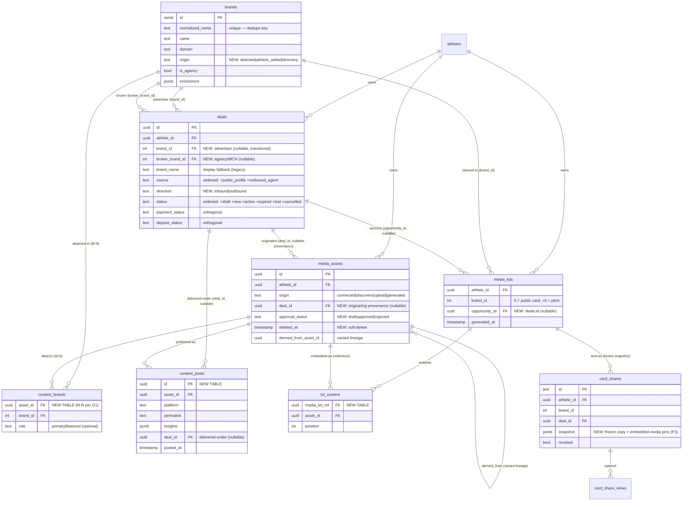

# Opportunity · Pitch · Content — the unified relationship model

**Status:** Proposed (for review) · **Author:** design session, Aug 2026
**Scope:** how deals/opportunities, brand identity, pitches, and athlete-created content
relate to one another — the data model, lifecycles, and an additive migration path.
**Nothing here is built yet.** This is the shared picture we build *from*.

---

## 1. Why this doc exists

Four things that are really facets of one system had drifted apart:

- **Opportunities** (`deals`) could only be born from a scanned email.
- **Pitches** (`media_kits` with `brand_id > 0`) were keyed only to a brand, with no notion
  of *which* engagement they were for, and no history.
- **Content** (ads/posts) had nowhere to live that linked it to a brand or a deal.
- **Brand identity** was represented two different ways — a real id in some places
  (`media_kits.brand_id`) and free text in others (`deals.brand_name`) — so the pieces
  didn't cross-reference.

This doc unifies them around a single spine and resolves the contradictions surfaced by
pressure-testing the model.

---

## 2. The spine

Everything is **owned by the athlete**. The **opportunity** is optional connective tissue:
when present, it ties a pitch and the content produced under it into one partnership timeline.

```
athlete ── owns everything ──►
   ├── opportunity (deals)     brand_id, source, direction   ← email OR self-created OR inbound-submitted OR outbound-agent
   │        ├── pitch(es)      how you won / re-pitched it
   │        └── content(s)     ads/posts made during it
   ├── pitch    (media_kits >0)   opportunity_id?   ← nullable → cold/speculative pitch
   └── content  (media_assets)    brand_id? deal_id?  ← both nullable → athlete-first
brands (catalog)  ◄─── deals, pitches, content all point here via brand_id
```

Two mental anchors:

- **A pitch is not a new thing** — it's a brand-tailored media kit. Same table, same engine,
  same card renderers. `brand_id = 0` is the generic public card; `brand_id > 0` is a pitch.
- **A pitch *persuades*; content *delivers*.** Both are "a thing an athlete makes for a brand,"
  but they sit at different points in the partnership lifecycle.

---

## 3. Decision ledger

### Decided

| # | Decision |
|---|----------|
| D1 | **One spine.** The opportunity (`deals`) is the connective tissue. A post-partnership campaign is a **new opportunity with the same brand**, not a new concept. |
| D2 | **Pitch = brand-tailored media kit.** Scope = `(athlete, brand, opportunity_id?)`; `opportunity_id` null ⇒ cold/speculative pitch. |
| D3 | **One *current* pitch per anchor; history via freeze-on-send snapshots.** Old pitches are read-only history, never editable duplicates. |
| D4 | **Unified deal hub** — one `deals` table, all origins, distinguished by `source` + a new `direction` (`inbound`/`outbound`). |
| D5 | **Self-created opportunities** allowed (`source='self_reported'`), created in the Opportunities surface. |
| D6 | **Content is athlete-first** — `brand_id` and `deal_id` both nullable. Personal → brand → deliverable, same asset graduating up. |
| D7 | **Content embeds into kits by reference** (a join table), never by copying. |
| D8 | **Payment/deposit status stay orthogonal** to the lifecycle `status` — never overloaded into it. |
| D9 | **Promote the brand catalog *in place*.** `inbox_brands` is already a general brand-identity table; add an `origin` column and treat it as the catalog. **Keep the physical table name** (105 code refs + 43 SQL refs incl. agent tools) — the rename is cosmetic and deferred. |
| D10 | **`deals.brand_id` becomes a real FK** to the catalog (nullable during transition, `brand_name` kept as display fallback). This is what makes the hub cross-reference. |
| D11 | **Pitch versioning starts minimal** (freeze content on send). Rich version tree/diff/revert deferred until demand appears; freeze-on-send snapshots are its raw material, so it's a strict prefix. |
| D12 | **`whyFits` reads a shared brand-fit record, not its own copy.** The pitch card and the voice brief both source the `(athlete, brand) → {audience, credibility, whitespace}` triple from the voice team's `brand_fit_narratives` table — one generator, one truth. See §12. |

### Surfaced by pressure-testing (recommended, need ratification)

| # | Decision | Rec |
|---|----------|-----|
| P1 | Deals need an optional **`broker_brand_id`** (the agency/MCN) distinct from the advertiser `brand_id`. | **Ratified** |
| P2 | Status vocabulary gains **`draft`**, renames `detected`→`new`, splits **`active`** from `completed`, and adds terminal **`expired`/`lost`/`cancelled`**. | Adopt |
| P3 | **Freeze-on-send must snapshot embedded media too** (pin pixels/asset-version), reconciling D7 (live reference) with D3 (immutable snapshot). *Non-optional — otherwise D3 and D7 contradict.* | Adopt |
| P4 | Publishing gets a **`content_posts` child table** (one asset → many posts across platforms); deal-delivery linkage lives here, not on the asset. | Add |
| P5 | Brand association means **"depicts/serves brand X"** and is **many-to-many** (`content_brands`, per O1); cross-brand embedding is governed by a **clearance** check (rival-leakage), not by the tags. | Adopt |
| P6 | Assets get **soft-delete + a referential guard** (a referenced asset can't hard-delete; post records survive). | Add |
| P7 | Content gets a **clearance/approval state** (`draft→approved→rejected`) gating embed/post — esp. generated + brand content (the Ad Studio approval gate). | Add |
| P8 | `asset.deal_id` = **originating deal (provenance)**, immutable; reuse under later deals is tracked via `content_posts`/embeds. | Adopt |

### Resolved (this review)

| # | Decision |
|---|----------|
| O1 | **content→brand is many-to-many** via a `content_brands` join — a piece can depict/serve more than one brand (co-branded content). `media_assets` carries **no** `brand_id`; association lives in the join. |
| O2 | **Do NOT physically rename `inbox_brands`→`brands` now.** Promote in place (add `origin`). The rename collides with large in-flight work from Aaron and Aditya — see §11. Revisit only after those branches land, as a solo migration with a compat view. |
| O3 | **Pitch snapshot is a column on `card_shares`** (it already freezes `custom_html`). A dedicated `pitch_snapshots` table is deferred until snapshots grow rich. |

| O4 | **`media_kits` uniqueness uses two partial unique indexes** (not a sentinel): one on `(athlete_id, brand_id, opportunity_id) WHERE opportunity_id IS NOT NULL`, one on `(athlete_id, brand_id) WHERE opportunity_id IS NULL`. Requires replacing the composite PK with a surrogate `id` — see §5. |
| P1 | **Ratified** — `deals` gets `broker_brand_id` (nullable). |

### Still open (yours to call)

*None blocking.* All design decisions are made. Remaining items are **build-sequencing**, not
design (see §10): the `detected→new` status rename ripples into teammates' test fixtures, and
migration numbering/mechanism needs reconciling with the `migrations/*.sql` series.

---

## 4. ER diagram

> Brand catalog shown as `brands` (physical table stays `inbox_brands` per **D9**).
> **Bold-intent columns** below are new/changed; see §5 for details.



---

## 5. Entities — what changes

### `brands` (physical: `inbox_brands`) — **D9**
Already a general, cross-athlete brand-identity catalog (name, domain, logo, category, tier,
audience, known partnerships, enrichment, `is_agency`). **Add `origin`** (`detected` |
`athlete_added` | `directory`) so brands discovered by outbound/public-profile can live here.
Dedupe stays keyed on `normalized_name` (handled today by `brandResolver`).

### `deals` (the opportunity hub) — **D4, D5, D10, P1, P2**
- **`brand_id`** (FK → `brands`, nullable transitional) + **`broker_brand_id`** (FK, agency).
  Keep **`brand_name`** as a display fallback for unresolved legacy rows.
- **`direction`** (`inbound` | `outbound`) — orthogonal to `source`.
- **`source`** widened: `+ public_profile`, `+ outbound_agent`.
- **`status`** — see §6.1 machine.
- `payment_status` / `deposit_status` unchanged and **kept orthogonal** (D8).

### `media_kits` (public card **and** pitches) — **D2, D3, O4**
- **`opportunity_id`** (FK → `deals`, nullable). Pitch identity becomes
  `(athlete_id, brand_id, opportunity_id)`. Public card = `brand_id 0, opportunity_id null`.
- **Uniqueness (O4) — not purely additive.** Today the identity is a composite **primary key
  `(athlete_id, brand_id)`** (`media_kits_pkey`), which caps it at one kit per brand. To allow
  opportunity-scoped pitches the migration must:
  1. **Add a surrogate `id uuid` primary key** and **drop the composite PK** (a nullable
     `opportunity_id` can't join a PK — PK columns are `NOT NULL`).
  2. Add **two partial unique indexes**:
     `UNIQUE (athlete_id, brand_id, opportunity_id) WHERE opportunity_id IS NOT NULL`
     and `UNIQUE (athlete_id, brand_id) WHERE opportunity_id IS NULL`.
  3. **Retarget the one upsert** — `kitCache.ts` `onConflictDoUpdate` currently conflicts on
     `[athlete_id, brand_id]`; point it at the `WHERE opportunity_id IS NULL` index for the
     general/public kit (opportunity-scoped kits upsert on the other).
- **Safety:** verified nothing FK-references `media_kits` (0 dependents) and neither Aaron's nor
  Aditya's branches touch this table — so the PK swap is isolated to the pitch/kit system.

### `media_assets` (content) — **D6, P6, P7, P8**
- **`deal_id`** (FK, nullable) = *originating* deal (immutable provenance).
- **`approval_status`** (`draft`|`approved`|`rejected`) gates embed/post.
- **`deleted_at`** soft-delete. Existing inline `permalink`/`insights` stay valid for
  *ingested* IG rows; athlete-*created* multi-post content uses `content_posts`.
- **No `brand_id`** — brand association is many-to-many, in `content_brands` (O1/P5).

### `content_brands` — **NEW (O1, P5)**
The many-to-many brand tag: `(asset_id, brand_id, role?)`. A piece can depict/serve more than
one brand (co-branded). `role` (`primary`|`featured`) is optional for ranking/display. Absence
of any row = personal/unbranded content. Cross-brand *embedding* is still governed by clearance,
not by these tags.

### `kit_content` — **NEW (D7)**
The reference-embed join: `(media_kit_ref, asset_id, position)`. One asset → many kits;
one kit → many assets. Editing an asset propagates to the *working* kit; sent snapshots are
frozen (P3).

### `content_posts` — **NEW (P4, P8)**
One asset → many posts: `(asset_id, platform, permalink, insights, posted_at, deal_id?)`.
This is where **delivery-under-a-deal** is recorded, so a Q1 asset reused in a Q3 campaign
attributes correctly without mutating the asset.

### `card_shares` — **P3**
Already the send record (revoke/expiry/recipient gating, `custom_html`). Add a **`snapshot`**
that freezes *both* the rendered card copy **and** pins for embedded media (asset-version or
URL), so "what the recipient saw" survives later edits/deletes of the live asset.

---

## 6. Lifecycles

### 6.1 Opportunity status machine — **P2**

Two on-ramps (by `direction`) converging on one spine:

```
OUTBOUND:  draft ─► outreach_sent ─┐
           (agent/athlete)          │
                                     ▼
INBOUND:                 new / needs_review ─► negotiating ─► accepted
           (scan or profile submit)                              │
                                                                 ▼
                                             active (partnership delivering)
                                                                 │
                                                                 ▼
                                                            completed
   terminal from most states: rejected · expired · lost · cancelled
```

- `draft` — outbound only; nothing sent yet (**new**).
- `new`/`needs_review` — inbound landed; replaces `detected`, covers scanned **and** profile-submitted.
- `active` — accepted **and** delivering; split from `completed` so "delivering now" ≠ "done" (**new**).
- Terminals — `rejected` (declined), `expired` (no response, time-based from `outreach_sent`),
  `lost` (went elsewhere), `cancelled` (fell through post-accept).

### 6.2 Pitch versioning — **D3, D11, P3**
Working pitch is a single living `media_kits` row (editable, embeds live). **Sending freezes a
snapshot** onto the `card_shares` row — card copy **and** embedded-media pins — and the
recipient's opens/dwell attach to *that* snapshot. History = the trail of sent snapshots.
Rich diff/revert deferred (O3/D11).

### 6.3 Content: two independent lifecycles — **D6, D7, P4**
```
media_asset (origin, brand_id?, deal_id?, approval_status)
   ├── PUBLISH → content_posts (platform, permalink, insights, deal_id?)   [external]
   └── EMBED   → kit_content (kit, position) → pitch/kit                    [internal, reference]
```
A piece can do either, both, or neither. Graduation (personal → brand → deliverable) is just
filling in nullable links on the same row — history preserved.

---

## 7. Invariants & rules

1. **Brand identity dedupes** by `normalized_name` (one row per real advertiser); `is_agency`
   rows are brokers, never advertisers.
2. **Every real opportunity carries a `brand_id`** — mint a *thin* brand row
   (`origin=athlete_added`) if needed. `brand_id IS NULL` is a **transitional** state for
   legacy text-only deals, not a steady-state design.
3. **Cross-references are by id, never by name** — which is why rebrands (name/domain change)
   are a one-row update that keeps all history attached.
4. **Freeze-on-send pins embedded media** — a sent snapshot never changes when the live asset
   later changes (reconciles D7 with D3).
5. **Clearance gates embed/post** for branded + generated content; embedding a brand-tagged
   asset into a rival brand's kit warns (rival-leakage lens).
6. **Referenced assets can't hard-delete** — soft-delete; `content_posts` records survive
   regardless (the post historically happened).
7. **`status` is never overloaded** — `direction`/`source` are static provenance;
   `payment_status`/`deposit_status` are separate axes.

---

## 8. How the model answers the pressure tests

| Case | Resolution |
|------|------------|
| Brand emails *and* was outbound-targeted | One brand row (dedupe); two deals same `brand_id`; agent **surfaces** the duplicate, doesn't auto-merge. |
| Agency emails for gorjana | `brand_id`=gorjana, `broker_brand_id`=agency (P1). |
| Pitch a brand not in catalog | Mint a thin brand row (invariant 2). |
| Brand rebrands | One-row update; history stays (invariant 3 — validates D10). |
| Outbound pitch never answered | `outreach_sent → expired` (P2). |
| One ad depicts/serves two brands (co-branded) | `content_brands` M:N tags both; embedding into a rival kit governed by clearance (O1/P5). |
| Content outlives its deal | `asset.deal_id`=provenance; reuse tracked via `content_posts` (P8). |
| One asset posted to IG + TikTok | `content_posts` child rows (P4). |
| Reference-embed vs freeze-on-send | Working kit live; **send freezes embedded media** (P3). |
| Delete an embedded/posted asset | Soft-delete + guard; post record survives (P6). |
| Generated ad not yet cleared | `approval_status` gates embed/post (P7). |
| Personal post later licensed | Fill nullable `brand_id`/`deal_id`; history preserved (validates D6). |

---

## 9. Migration plan (additive, staged)

All additive — no destructive changes. Follows the repo convention: surgical, idempotent DDL
added to the deploy pipeline's hardcoded DDL block (not `drizzle-kit push`).

**Stage 1 — brand catalog & deal hub (foundation)**
1. `brands`: `ADD COLUMN origin text` (backfill existing → `'detected'`).
2. `deals`: `ADD COLUMN brand_id int`, `broker_brand_id int`, `direction text`.
3. Widen `deals_source_check` (+`public_profile`,`outbound_agent`) and `deals_status_check`
   (+`draft`,`new`,`active`,`expired`,`lost`,`cancelled`) — **same migration** does the
   `detected→new` `UPDATE` before swapping the CHECK.
4. **Backfill `deals.brand_id`** via `normalized_name` match; unmatched rows keep `brand_name`.

**Stage 2 — pitch anchoring** (O4 — *not purely additive*, but isolated to the pitch system)
5. `media_kits`: `ADD COLUMN id uuid DEFAULT gen_random_uuid()`, `ADD COLUMN opportunity_id uuid`;
   drop the composite PK `(athlete_id, brand_id)`, add surrogate PK on `id`, add the two partial
   unique indexes (§5); retarget the `kitCache.ts` upsert conflict. No FK dependents, so the PK
   swap is safe.
6. `card_shares`: `ADD COLUMN snapshot jsonb`; start writing frozen copy + media pins on send.

**Stage 3 — content**
7. `media_assets`: `ADD COLUMN deal_id uuid`, `approval_status text`, `deleted_at timestamptz`.
8. `CREATE TABLE content_brands` (M:N brand tags — `asset_id`, `brand_id`, `role`).
9. `CREATE TABLE kit_content` (embed-by-reference join).
10. `CREATE TABLE content_posts` (publish records).
11. Referential guard for soft-delete (app-level check + optional trigger).

**Sequencing:** Stage 1 unblocks everything (the brand-id spine). Stages 2 and 3 are
independent of each other and can land in either order.

**Non-goals / deferred:** rich pitch version tree (D11/O3), physical table rename (O2/D9 —
see §11), dedicated `pitch_snapshots` table (O3).

---

## 10. Build-ready — remaining items are sequencing, not design

**All design decisions are made.** P1 (`broker_brand_id`) and O4 (partial-index uniqueness) are
ratified; each migration stage in §9 is an independent, additive PR. What's left is
**coordination with in-flight work**, verified against Aaron's and Aditya's branches (Aug 2026):

- **Impact check — clean.** Neither engineer touches the `deals` or `media_kits` table blocks or
  their DDL; nothing FK-references `media_kits`. So **P1 and O4 don't collide** with their work.
  The O4 PK swap is isolated to the pitch/kit system (the only dependent is our own
  `kitCache.ts` upsert).
- **Sequence the status rename** (`detected→new`) after their branches land — it ripples into
  ~10+ of their **test fixtures** (`loop.test`, `draftReply.test`, …) plus the detector's insert.
- **Reconcile migrations** — the team uses `migrations/*.sql` (latest `0019`); our additive DDL
  should number `0020+` and/or land in the `deploy.yml` block (the actual executor). Agree the
  mechanism before the first PR.

None of these block design; they're merge-ordering.

---

## 11. Why the physical rename is deferred (evidence)

Investigated across `main`, all unmerged branches, and the live DB (Aug 2026). The rename
`inbox_brands → brands` is **not safe to do now** — it collides head-on with large in-flight
work from two engineers.

**Live DB — 3 tables FK into it:**
`inbox_senders`, `inbox_threads`, `brand_fit_narratives` all have
`... REFERENCES inbox_brands(id)`. Postgres auto-follows the table on `RENAME`, so the FKs keep
working — **but** the constraint *names* still embed `inbox_brands`
(`inbox_threads_brand_id_inbox_brands_id_fk`), and the deploy-pipeline DDL that recreates them
hardcodes the old name as a string.

**Active WIP that a rename would break / conflict with:**
- **Aditya** (`adi/mila-*-voice-*`) — a whole `server/voice/` brand subsystem not yet on main:
  `brandKnowledgeRoute`, `brandMatch`, `brandFitStore`, `brandFitFill`, `dealResolver`,
  `brandBriefRoute`, `dealBriefRoute`, plus scripts (`backfillBrandFit`, `migrateBrandFitFile`).
  All query the brand table.
- **Aaron** (`fix/deal-scoring-and-pdf-briefs`) — sits on top of that voice work and adds
  `migrations/0019_brand_fit_narratives.sql` with a **hardcoded** `REFERENCES "inbox_brands"("id")`.
- **Both** branches modify the exact three files a rename must edit — `shared/schema.ts`
  (the `pgTable("inbox_brands", …)` string + the new `brandFitNarratives` FK),
  `.github/workflows/deploy.yml` (the DDL), and ~20 brand-referencing source files — so a rename
  now **guarantees merge conflicts in `schema.ts` and `deploy.yml`** and forces both engineers
  to rebase ~30 files mid-flight.

**Blast radius if forced:** ~105 code refs (`inboxBrands`) + ~43 raw-SQL refs (`inbox_brands`,
which a TS refactor can't catch) + hardcoded constraint names + a landing migration (0019).

**Conclusion:** promote **in place** — `ADD COLUMN origin` only, keep the name. Zero collision,
zero rebase burden on Aaron/Aditya. If the clean name is ever wanted, do it as a **solo,
coordinated migration after their branches land**, using a compatibility view
(`CREATE VIEW inbox_brands AS SELECT * FROM brands`) so nothing breaks during the transition.

---

## 12. Shared brand-fit record — `whyFits` reads it, doesn't duplicate it

**Decision (D12 — ADOPTED).** `brand_fit_narratives` is the single source of truth for the
`(athlete, brand) → fit` triple; the pitch's `whyFits` card is a *view* of it, not its own copy.

The voice team (Aditya/Aaron) shipped a durable table, `brand_fit_narratives`, whose columns are
**exactly** the pitch system's `whyFits` angles:

```sql
brand_fit_narratives ( athlete_id, brand_id,
                       audience text, credibility text, whitespace text, … )
--                     ^^^^^^^^  ^^^^^^^^^^^  ^^^^^^^^^^  the same three angles
```

```js
// server/services/pitches.ts — the whyFits card generator
narrateWhyFits(...) // → { audience, credibility, whitespace }
```

Both are *"why this athlete fits this brand,"* keyed `(athlete, brand)`, as the same three
angles. Today they are **two generators + two stores** for one concept:

| | `whyFits` (pitch) | `brand_fit_narratives` (voice) |
|---|---|---|
| Fields | `audience`/`credibility`/`whitespace` | *the same three* |
| Generator | `narrateWhyFits` | voice `brandFitFill` path |
| Store | media-kit cache | its own table |
| Read by | pitch deck + Studio "confirm the angle" | voice brand/deal brief |

**Risk if left split:** the pitch deck and Mila's spoken brief can **drift** (different words for
the same fit), **double the LLM cost**, and require maintaining the fit logic in two places.

**The decision, concretely:**
- `narrateWhyFits` **writes** to `brand_fit_narratives` (upsert on `(athlete_id, brand_id)`) —
  it becomes the shared record's writer, not a private generator.
- The `whyFits` card and Studio insights **read** from `brand_fit_narratives`.
- The voice brand/deal brief keeps reading the same rows. One computation, one truth; pitch and
  voice always agree.
- **The existing `brand_fit_narratives` table is adopted as-is** — no rename now (its name is
  voice-flavored but it *is* the shared fit record). Same reasoning as `inbox_brands` in §11:
  it's in active use by shipped voice code; a rename would collide with in-flight work for a
  purely cosmetic gain. Revisit the name later if ever.

This is the concrete instance of the general hierarchy rule: things keyed `(athlete, brand)`
are shared records, not per-surface copies. **Do not build the pitch side to regenerate what the
voice side already stores.**
